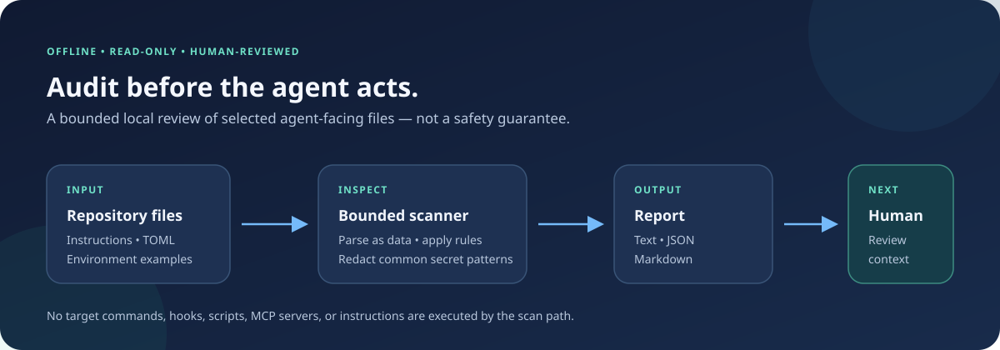
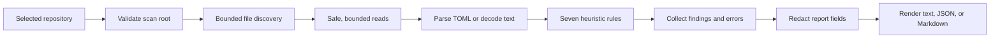
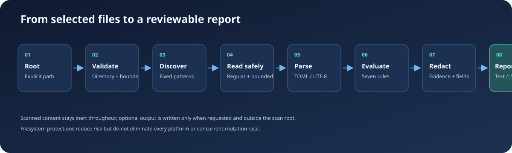
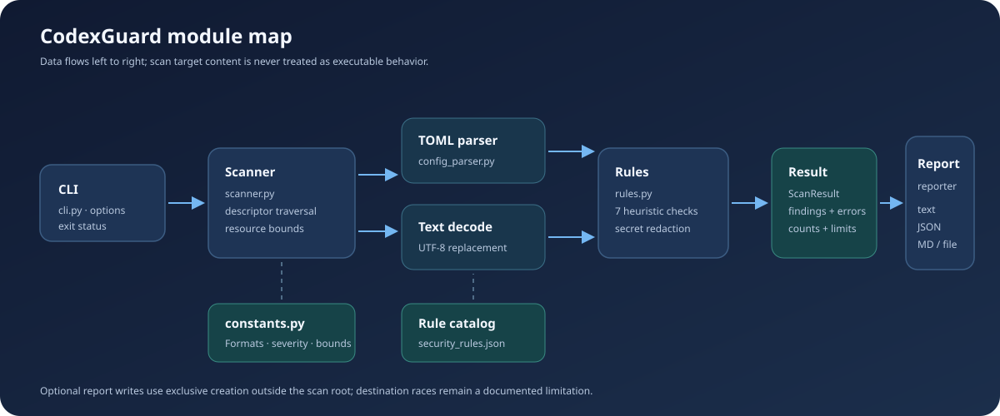
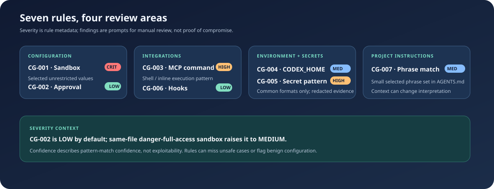
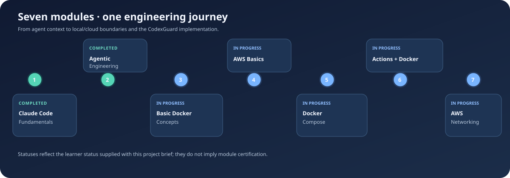

# CodexGuard

### Audit Before the Agent Acts.

An offline, read-only security auditing CLI that helps identify potentially risky AI-agent configurations and project instructions before an agent interacts with a repository.

[](pyproject.toml)
[](LICENSE)

**Repository:** [github.com/thunderstorm009/codex_guard](https://github.com/thunderstorm009/codex_guard) · Independent community project; not an official OpenAI product or endorsement.

CodexGuard reviews selected local files as untrusted data. It does not execute repository commands, hooks, scripts, MCP servers, or instructions, and it does not intentionally modify the selected tree. Its findings are heuristic review prompts, not proof that a repository is unsafe or safe.



## Why CodexGuard?

AI coding agents can read project instructions and configuration that influence how they work. Repositories may contain instructions, agent settings, MCP server definitions, hooks, and example environment files. Reviewing these inputs before agent interaction can help surface settings or text that deserve human attention.

CodexGuard offers a small, local-first review with bounded discovery, symlink-aware file handling, common-secret redaction, and terminal, JSON, or Markdown output. It is designed to inspect repository data without interpreting it as instructions or launching configured behavior.

## How a scan works



Discovery is limited to files named `AGENTS.md`, `.codex/config.toml`, `.env.example`, or `.env.*.example`. The scan uses descriptor-based traversal and no-follow behavior where supported, with limits for file size, entry count, directory count, depth, relevant files, and open directory descriptors. TOML is parsed into data; text is decoded as UTF-8 with replacement. Per-file errors are sanitized and reported separately when scanning can continue.



## Architecture

The CLI validates options and the explicit scan root, then the scanner discovers and reads candidate files. TOML files go through `config_parser`; text and parsed configuration go to rule evaluators in `rules`. Findings are collected in a `ScanResult`, redacted before serialization, and rendered by `reporter`. Optional report output uses exclusive file creation outside the scan root and refuses existing destinations.



See the [Architecture Guide](docs/architecture.md) and [Source Code Guide](docs/source-code-guide.md) for the module-by-module walkthrough.

## Security rules

The default severity is shown below. CG-002 is LOW by default and is raised to MEDIUM when the same parsed configuration contains `sandbox_mode = "danger-full-access"`.

| Rule | Default severity | What it checks |
|---|---:|---|
| [CG-001 Dangerous Sandbox Configuration](docs/security-rules.md#cg-001--dangerous-sandbox-configuration) | Critical | Selected explicit sandbox values that indicate disabled or bypassed restrictions. |
| [CG-002 No-Prompt Approval Policy](docs/security-rules.md#cg-002--no-prompt-approval-policy) | Low; conditional Medium | `approval_policy = "never"`, using the sandbox value in that file for severity context. |
| [CG-003 Suspicious MCP Configuration](docs/security-rules.md#cg-003--suspicious-mcp-configuration) | High | MCP commands with shell, download-to-shell, or inline Python patterns. |
| [CG-004 CODEX_HOME Redirection](docs/security-rules.md#cg-004--codex_home-redirection) | Medium | `CODEX_HOME` assignments in discovered environment examples. |
| [CG-005 Potential Secret Exposure](docs/security-rules.md#cg-005--potential-secret-exposure) | High | Values matching selected common credential and private-key patterns. |
| [CG-006 Hook Requires Manual Review](docs/security-rules.md#cg-006--hook-requires-manual-review) | Low | Presence of a non-empty `hooks` setting; this alone does not mean unsafe behavior. |
| [CG-007 Suspicious Project Instructions](docs/security-rules.md#cg-007--suspicious-project-instructions) | Medium | A small set of instruction override, exfiltration, and download-to-shell phrases in `AGENTS.md`. |



Rule metadata lives in [`rules/security_rules.json`](rules/security_rules.json) and its packaged copy at [`codexguard/security_rules.json`](codexguard/security_rules.json). Implementations and detection boundaries are described in [Security Rules](docs/security-rules.md).

## Install and use

### Prerequisites

- Python 3.9 or newer. Python 3.9/3.10 remain declared compatibility versions but are end-of-life and not security-supported runtimes.
- A complete source tree containing `pyproject.toml`.

### Install from a checkout

```sh
python3 -m pip install -e .
codexguard --help
```

The application has no third-party runtime dependency on Python 3.11+; Python 3.9/3.10 use the declared `tomli` compatibility dependency.

### Run an audit

```sh
codexguard scan ./project
codexguard scan ./project --format json
codexguard scan ./project --format markdown
codexguard scan ./project --min-severity HIGH
codexguard scan ./project --format json --output ./reports/audit.json
codexguard rules
codexguard version
```

`scan_root` is an explicit directory argument; CodexGuard does not choose a repository for you. Supported formats are `text` (default), `json`, and `markdown`. `--output PATH` must point outside the scan root and to a destination that does not already exist. The output directory must already exist. `--min-severity` filters displayed findings and determines the findings exit status; `--severity` is a compatibility alias. `--quiet` suppresses the terminal report.

Exit codes are `0` for a completed scan with no qualifying findings, `1` for qualifying findings, `2` for invalid arguments or scan root, and `3` for an operational scan or report-write failure. Per-file errors can appear in a completed report without making the entire scan fatal. Reports contain tool/version, scan summary, findings (rule, location, evidence, assessment, confidence, rationale, recommendation), and scan errors. Confidence describes the pattern match, not exploitability.

The CLI renders **text** by default and also supports **JSON** and **Markdown**. Save a report with `--output` to a new path outside the scan root; the output parent must already exist. See [CLI Reference](docs/usage/cli-reference.md) and [Report Formats](docs/usage/report-formats.md).

## Project structure

```text
codexguard/          CLI, scanner, parser, rules, reporter, packaged rule data
rules/               source security rule catalog
tests/               scanner, parser, rules, reporter, CLI, and packaging tests
fixtures/            synthetic vulnerable and hardened sample repositories
docker/              digest-pinned Python image definition
.github/workflows/   repository test and security-check workflows
docs/                architecture, security, usage, evidence, and learning guides
```

## Run in Docker

The Dockerfile uses a digest-pinned `python:3.12-slim` base image and configures UID/GID `10001:10001`. The container command below disables networking, makes the container root filesystem and scan mount read-only, drops all Linux capabilities, enables no-new-privileges, and sets memory, CPU, and PID limits. Reports use a separate writable mount.

```sh
docker build -f docker/Dockerfile -t codexguard:latest .
mkdir -p reports
docker run --rm --network none --read-only --cap-drop ALL \
  --security-opt no-new-privileges --memory 256m --cpus 1 --pids-limit 64 \
  --mount type=bind,src="$(pwd)/fixtures/vulnerable",dst=/scan,readonly \
  --mount type=bind,src="$(pwd)/reports",dst=/reports \
  codexguard:latest scan /scan --format json --output /reports/audit.json
```

The report directory must be writable by UID 10001. The vulnerable fixture is expected to produce findings and return 1. Host kernel, daemon, mount implementation, and permissions still matter; these Docker settings are not a complete isolation guarantee. See the [Docker Guide](docs/docker-guide.md).

## Tests and fixtures

The test suite is organized by scanner traversal, TOML parsing, individual rules, reporting, CLI behavior, and package/Docker/workflow metadata. Tests include no-execution and no-network tripwires, bounded and malformed file cases, symlink/path-swap cases, secret-redaction checks, and report destination safety checks. The vulnerable fixture is synthetic and exercises CG-001 through CG-007; the hardened fixture represents a lower-risk baseline. Existing recorded evidence says the vulnerable fixture produces 8 findings over 3 files and the hardened fixture produces none over 2 files. These are prior project records, not checks run for this documentation update.

See [Tests and Fixtures](docs/tests-and-fixtures.md), [`tests/`](tests/), and [`fixtures/`](fixtures/).

## Security boundaries and limitations

- Detection is heuristic and limited to supported discovery patterns and the seven implemented rules.
- Findings require context-aware human review. A clean report is not a safety guarantee.
- CodexGuard does not execute scanned content, automatically remediate findings, or enforce access control over Codex.
- It does not calculate every effective Codex setting or inspect all host state.
- Secret redaction and detection cover selected common formats; unknown, split, encoded, or custom secrets may be missed.
- Filesystem protections reduce risk but cannot eliminate every platform-specific or same-user concurrent race. Ordinary reads can update access time on some filesystems.

Read the [Security Model](docs/security-model.md), [Threat Model](docs/threat-model.md), and [Security Checklist](docs/security-checklist.md) for scope and residual risks.

## Learning journey

Follow the hands-on learning path from coding-agent fundamentals through agentic engineering and Docker isolation to CodexGuard's implementation. Each module contains objectives, guided tasks, repository connections, reflection questions, and a place for lab screenshots or notes. The exercises use synthetic examples and avoid asking learners to run untrusted repository content.



**[Start the seven-module learning path →](docs/learning-path/README.md)** · [Learning-to-project mapping](docs/learning-path/LEARNING-TO-CODEXGUARD.md)

Each standalone guide links to the requested Poridhi module. The source pages did not expose lesson bodies to this documentation pass, so the guides distinguish the topics supplied in the project brief from verified CodexGuard implementation facts and do not invent Poridhi commands or results.

## Project navigation

| Guide | What you'll find |
|---|---|
| [Documentation Index](docs/README.md) | Browse technical guides by topic. |
| [Learning Path](docs/learning-path/README.md) | Guided modules and lab-to-project connections. |
| [Architecture](docs/architecture.md) | Scan data flow, modules, and resource bounds. |
| [Source Code Guide](docs/source-code-guide.md) | How to navigate the implementation. |
| [Security Model](docs/security-model.md) | Implemented controls and important limits. |
| [Threat Model](docs/threat-model.md) | Assets, threats, assumptions, and residual risks. |
| [Security Rules](docs/security-rules.md) | Exact rule behavior and severity. |
| [Docker Guide](docs/docker-guide.md) | Image design and restricted execution example. |
| [Tests and Fixtures](docs/tests-and-fixtures.md) | Test organization and synthetic sample repositories. |
| [CLI Reference](docs/usage/cli-reference.md) · [Report Formats](docs/usage/report-formats.md) | Exact flags, output structures, and exit codes. |
| [Filesystem Safety](docs/security/filesystem-safety.md) | Descriptor traversal, resource limits, and residual races. |
| [Contributing](CONTRIBUTING.md) | Change and documentation guidelines. |
| [Project Status](docs/project-status.md) · [Experiment Results](docs/experiment-results.md) | Existing dated verification records and their scope. |

## From learning to implementation

CodexGuard turns ideas from secure AI-assisted development and infrastructure engineering into a concrete audit workflow: define a trust boundary, treat repository content as inert input, bound filesystem work, make container permissions explicit, and present evidence for human review. The project is an educational and practical tool, not a substitute for careful configuration review or defense in depth.

Licensed under the [MIT License](LICENSE).
