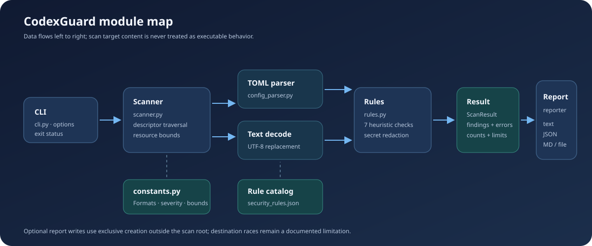

# CodexGuard Documentation

Use this page to navigate the project documentation. The root [`README.md`](../README.md) is the quick project introduction and command entry point; detailed architecture and security behavior live in the canonical guides below.

| Area | Start here | Related guides |
|---|---|---|
| Architecture | [Architecture Guide](architecture.md) | [Workflow diagram](assets/codexguard-workflow.svg), [filesystem safety](security/filesystem-safety.md), [source walkthrough](source-code-guide.md) |
| Security | [Security Model](security-model.md) | [Rules](security-rules.md), [Threat Model](threat-model.md), [Docker Guide](docker-guide.md), [Checklist](security-checklist.md) |
| Development | [Development index](development/README.md) | [Tests and fixtures](tests-and-fixtures.md), [Contributing](../CONTRIBUTING.md), [Project Status](project-status.md) |
| Usage | [Usage index](usage/README.md) | [CLI reference](usage/cli-reference.md), [Report formats](usage/report-formats.md), [Docker usage](docker-guide.md) |
| Learning | [Seven-module learning path](learning-path/README.md) | [Learning-to-project mapping](learning-path/LEARNING-TO-CODEXGUARD.md) |
| Evidence | [Experiment Results](experiment-results.md) | [Release Readiness](release-readiness.md), [Dependency Security](dependency-security.md) |

CodexGuard is an offline, read-only heuristic CLI for selected repository files. It is not an MCP server, cloud scanner, malware detector, access-control mechanism, or guarantee of safety. See the [Threat Model](threat-model.md) for its scope.
