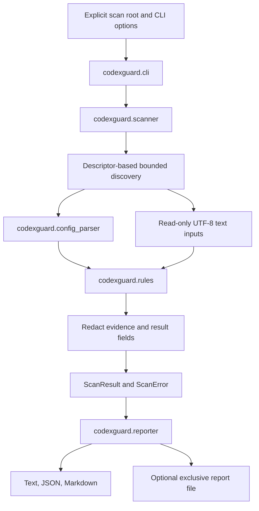

# Architecture

CodexGuard is a Python CLI that inspects a user-selected directory as untrusted data. The scan path is designed to be offline, read-only, and non-executing. This describes the current source implementation; it is not a claim that every platform or hostile concurrent filesystem condition is fully contained.

## Modules

- `codexguard.cli` parses `scan`, `version`, and `rules`, validates output format and severity options, renders results, and maps failures/findings to exit codes.
- `codexguard.__main__` delegates to the same CLI `main()` function. `__init__` exposes version metadata without scan side effects.
- `codexguard.constants` defines name/version, formats, severities, and default bounds.
- `codexguard.scanner` validates the explicit scan root, walks the tree, opens relevant files, invokes parsers and rules, and accumulates a `ScanResult` with findings, per-file errors, counters, and limit notices.
- `codexguard.config_parser` parses TOML using `tomllib` when available and `tomli` on older Python versions. Parser and file errors are normalized into sanitized error objects.
- `codexguard.rules` contains independent TOML/text evaluators, rule metadata loading, and common secret redaction.
- `codexguard/reporter.py` renders a consistent result as text, JSON, or Markdown, and safely creates a requested report file.
- `rules/security_rules.json` is the source rule catalog; `codexguard/security_rules.json` is bundled package data. Tests check the copies stay aligned.

## Discovery and resource limits

The scanner only starts from the explicit root supplied to `scan`. It considers:

- Any file named `AGENTS.md`.
- `.codex/config.toml` files.
- `.env.example` and `.env.*.example` files.

Default bounds in `constants.py` are:

| Bound | Default |
|---|---:|
| Bytes read per file | 1 MiB |
| Relevant files | 5,000 |
| Total directory entries visited | 50,000 |
| Directories visited | 1,000 |
| Directory depth | 20 |
| Open directory descriptors | 64 |

The scan result reports visited counts and any reached limits. Oversized, malformed, and unreadable files are skipped with sanitized per-file errors rather than aborting the entire scan, when the scan root itself remains usable.

## Secure file reading

The scanner pins the root and traversed directories with descriptors, opens child paths relative to their parent descriptor, and uses no-follow flags where supported. Symlinked directories are not traversed, and relevant symlink files are not followed. Reads are read-only, regular-file checked, and bounded. The TOML parser's standalone file API separately enforces scan-root containment and bounded descriptor-based reads.

These techniques reduce traversal and path-replacement races; they are not a complete race-proof guarantee across all operating systems and filesystems. Required descriptor primitives are checked and unsupported scanner environments fail closed. Windows, network filesystems, unusual mount behavior, and hostile concurrent mutation have not been exhaustively tested. Reads do not intentionally modify files, though some filesystems can update atime as a consequence of a read.

## Parsing, rules, and redaction

TOML is parsed into inert Python data. Text files are decoded as UTF-8 with replacement for invalid bytes. No project instructions are followed. Commands in hooks or MCP configuration are never passed to a shell or process API, and no MCP server is started.

Rule evaluation separates matched evidence from an assessment, confidence label, rationale, and recommendation. The confidence label describes the pattern match; it is not a probability of exploitability. CG-002 considers the approval and sandbox values available in the parsed file, but cannot calculate all effective configuration layers. CG-006 is a low-severity manual-review warning for hook presence, not a claim that the hook is unsafe. The complete rule catalog, examples, and limits are in the [README](../README.md#rules).

The redactor recognizes selected common assignment, token, bearer, URL credential, and private-key forms. It runs before findings enter reports, and report serialization also redacts paths and error fields. Pattern matching is incomplete: unknown encodings, split values, unusual provider formats, and novel secret types can evade it.

## Reporting and CLI behavior

The CLI defaults to human-readable text. JSON and Markdown can be selected with `--format`. A report path is accepted only when explicitly supplied and must resolve outside the scan root. The writer refuses an existing destination and uses exclusive creation; it also rejects symlink destinations and unsafe parent components where supported. Partial output is removed on a failed write. Report directories should be private and controlled because a same-user concurrent process may still race output paths on some platforms.

Exit codes are 0 for a completed scan with no qualifying findings, 1 for qualifying findings, 2 for invalid arguments or root input, and 3 for operational failure. File-level errors appear separately in the report and may coexist with a completed scan.

## Security boundary

The scanner's intended boundary is the explicitly selected tree and bounded data it reads. It does not read arbitrary absolute paths based on scanned content, execute discovered behavior, make network requests, or remediate files. This does not imply complete Codex policy evaluation, full secret detection, or certification. See the [Threat Model](threat-model.md), [Security Model](security-model.md), and [Security Checklist](security-checklist.md).
