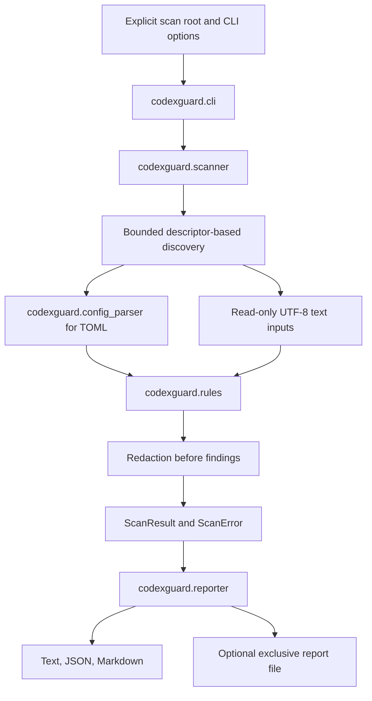

# Architecture

CodexGuard is a local Python CLI. It has no subprocess, command execution, or network client in the scan path.

## Module responsibilities

- `cli.py` parses `scan`, `version`, and `rules`, selects threshold/format, and maps outcomes to exit codes. `__main__.py` delegates to the same `main()` function.
- `constants.py` contains shared app/version, severity, format, and resource-limit constants. `__init__.py` exposes the version without scan side effects.
- `scanner.py` validates and pins the explicit root, discovers a bounded set of relevant files, inspects them as data, aggregates findings and per-file errors, and tracks limit reports.
- `config_parser.py` parses TOML bytes using `tomllib` or the Python 3.9/3.10 `tomli` fallback. File reads use bounded descriptor-based access and sanitized errors.
- `rules.py` loads seven JSON rule records, evaluates parsed settings or inert text, and redacts matched evidence before returning findings.
- `reporter.py` renders a shared result schema and optionally creates a new report file with exclusive creation outside the scan root.

## Data flow and discovery

The caller must supply a scan root. The scanner examines `.codex/config.toml`, files named `AGENTS.md`, and `.env.example` or `.env.*.example`. It counts total entries and directories as well as relevant files, applies depth and file-size bounds, does not descend through symlinked directories, and records reached limits in its summary. Files are opened read-only relative to pinned directory descriptors where supported. Unsupported required traversal primitives fail closed.

TOML and text are parsed as untrusted data. Instruction text is never followed. MCP command strings, hooks, and scripts are never started. The TOML parser is isolated from filesystem discovery so it can be tested separately.

## Rule engine and finding generation

The scanner passes parsed TOML objects and decoded text to independent rule evaluators. Rule metadata is maintained in `rules/security_rules.json` and bundled at `codexguard/security_rules.json` so installed distributions do not depend on the repository layout. A packaging test checks that these copies remain identical. Findings record location, evidence, heuristic assessment, a rule-level confidence label for the pattern match, rationale, and remediation. Confidence does not indicate exploitability or effective runtime behavior. The evidence and text are redacted before serialization. Heuristic findings are review prompts rather than proof of exploitable behavior.

## Reporting

Text, JSON, and Markdown render from the same `ScanResult` dictionary. Optional output requires an explicit path outside the scan root and refuses existing files. The writer uses exclusive creation and guarded parent traversal; it removes a partial report when a write fails and can verify the created file identity before cleanup.

## Security boundaries and limitations

Scans are designed to make no network requests and never execute discovered content. The code does not mutate scan files. Descriptor-relative opening and no-follow flags reduce symlink and path replacement races where supported, but platform semantics and concurrent filesystem changes leave residual risk. Redaction and detections are pattern-based, and discovery covers a defined subset of file types. A report output path is user-selected and must be separate from the scan root.
