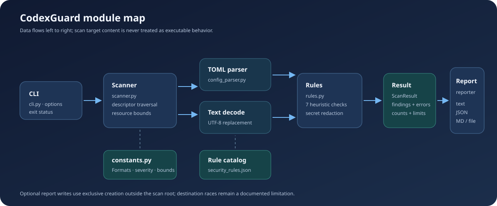

# Architecture Documentation

The canonical architecture explanation is [`../architecture.md`](../architecture.md). It describes actual modules, file discovery, bounded traversal, parsing, rules, redaction, and report output.

Related views:

- [Repository scan workflow](../assets/codexguard-workflow.svg)
- [Rule-evaluation process](../assets/rule-evaluation.svg)
- [CLI reporting flow](../assets/cli-reporting.svg)
- [Filesystem safety boundaries](../security/filesystem-safety.md)
- [Source code walkthrough](../source-code-guide.md)
