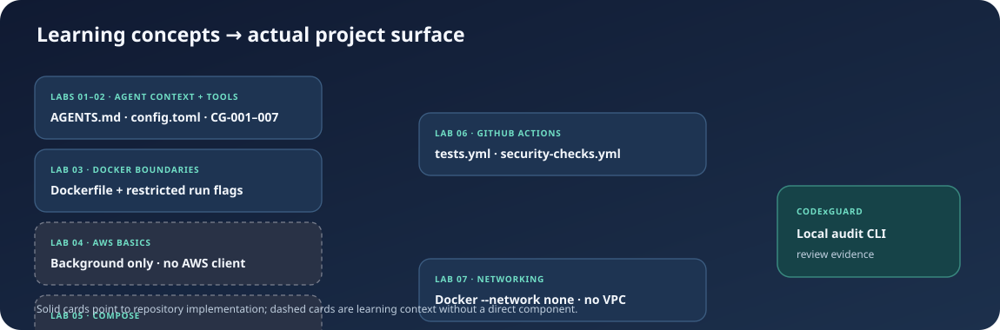
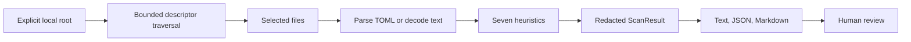

# Learning-to-project mapping

| Module concepts | Project component | Connection and limit |
|---|---|---|
| Agent setup, permissions, context, instructions | `AGENTS.md`, `.codex/config.toml`, CG-001/002/007 | The scanner spots selected configuration values and instruction phrases. It does not reproduce Claude Code or evaluate complete Codex runtime policy. |
| Tool use, integrations, hooks | `codexguard/rules.py`, CG-003/006 | MCP command patterns and hook presence become review findings; the scanner never starts them. |
| Container image, user, mounts, resource limits | `docker/Dockerfile`, `docs/docker-guide.md` | The image uses UID/GID 10001; runtime flags supply additional boundaries. Docker is optional and not the scanning engine. |
| AWS identity, compute, network | No AWS module or provider | Background for infrastructure threat modeling only; no AWS API, SDK, cloud deployment, or VPC is implemented. |
| Compose orchestration | No Compose manifest | Compose is a possible deployment option a maintainer could develop; it is not current project configuration. |
| CI/CD and workflow permissions | `.github/workflows/tests.yml`, `.github/workflows/security-checks.yml` | Repository workflows define checks for this code and fixtures. They do not provide a reusable CodexGuard Action or guarantee a hosted run passed. |
| VPC routing and isolation | `--network none` in documented Docker invocation | The container example disables container networking. There is no AWS networking code; host and daemon boundaries remain. |

## One scan, conceptually

The learning path moves from broad infrastructure concepts to the concrete pipeline shown below. The input content remains inert: configuration is parsed, text is pattern-matched, and the final output is evidence for a reviewer.

There is no step that launches an MCP server, runs a hook, requests AWS credentials, invokes GitHub Actions, or blocks an agent. Optional report writing is distinct from scanning and writes only when a destination is explicitly requested outside the scan root.
