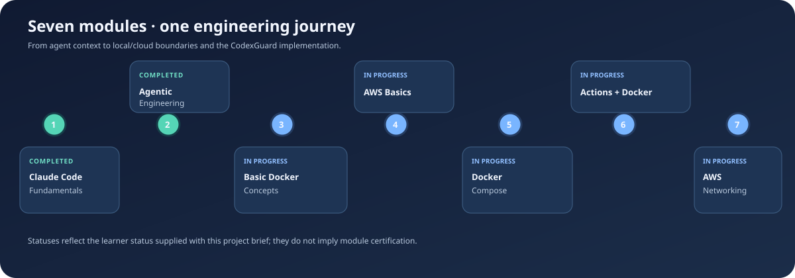

# Poridhi Learning Path: From Agent Concepts to CodexGuard

This path connects hands-on learning about coding agents, agentic engineering, and Docker to the implementation of CodexGuard. It uses this repository as a case study: each module moves from a concept to a specific source file, control, or limitation.

> These are repository learning notes, not copied Poridhi lab manuals. The request did not include exact Poridhi course names, lab titles, or URLs, so no proprietary lab sequence is claimed. Pair the module with your assigned Poridhi material and record its actual title/ID in the module's image or notes directory.

## How to use the path

1. Complete the related Poridhi lab using its provided environment and instructions.
2. Use the module tasks to connect the lab concepts to CodexGuard. Do not paste or run commands from an untrusted repository during an audit exercise.
3. Follow source links and write down one implementation choice and one limitation.
4. Save your own diagrams or screenshots in that module's `images/` directory. Redact account details, tokens, private hostnames, and personal data first.
5. Read [Connection to CodexGuard](CONNECTION-TO-CODEXGUARD.md) after all modules.

## Modules

| Module | Focus | Project connection |
|---|---|---|
| [01 — Claude Code Fundamentals](01-claude-code-fundamentals/README.md) | Coding agents, context, tools, instructions, and trust boundaries. | Why repository instructions and configuration merit review. |
| [02 — Agentic Engineering](02-agentic-engineering/README.md) | Delegation, tool permissions, human review, and safe workflows. | Why CodexGuard reports evidence for people instead of making policy decisions. |
| [03 — Basic Docker Concepts](03-basic-docker-concepts/README.md) | Images, containers, users, mounts, and process boundaries. | The actual CodexGuard Dockerfile and restricted invocation. |
| [04 — Container Hardening Lab](04-container-hardening/README.md) | Least privilege, read-only filesystems, network and resource limits. | Which controls are in the Dockerfile and which are run-time flags. |
| [05 — Build the Audit Pipeline](05-build-the-audit-pipeline/README.md) | Bounded file discovery, parsing, rules, redaction, reporting. | Trace a file from scan root to report without executing its contents. |

## Learning outcomes

By the end, you should be able to explain how agent context can carry risk, distinguish a heuristic warning from a security verdict, describe container controls and their limits, trace CodexGuard's scan pipeline, and identify where a security claim is supported by source or test intent.

## Safe practice

Use synthetic examples and the provided fixtures. Do not add real credentials, connect a personal Codex configuration, or start commands/hooks/MCP servers found in a project being audited. Running a container image build executes its Dockerfile; only build source you trust and inspect. Existing project test and validation records are historical evidence; the documentation update itself does not rerun them.
