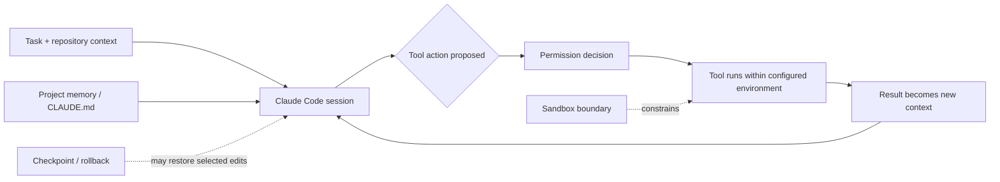

# Lab 01 — Claude Code Fundamentals

**Type:** Theoretical and hands-on 
**Level:** Beginner to intermediate 
**Estimated Duration:** Poridhi duration was not available in the supplied listing. Suggested study time: 90–120 minutes across seven topics (editorial estimate). 
**Learning Module:** [Claude Code Fundamentals — Poridhi](https://poridhi.io/lab-group-modules/6a0eb7c3bfa7b7946e2362ab/6a0ec44923b200e2a41c663e)

## 1. Introduction

An AI coding agent combines a language model with context and tools such as file reading, editing, a terminal, and integrations. Its effective security depends on what it can see and do, which actions require approval, and which instructions it treats as relevant. Claude Code is one such agent. CodexGuard is a separate Codex-focused repository auditor; it does not implement Claude Code features.

This lab studies the controls around an agent rather than treating model output as the only security boundary. The exact Poridhi lesson content was not readable in the supplied web module page, so the sequence below follows the seven topic names included with this request and points to official Claude Code references for product-specific behavior.

## 2. Lab Overview

The module moves through installation and settings, session/context controls, outage debugging, permissions, Docker and native sandboxing, rollback, and project memory. The exercises ask you to inspect settings and reason about boundaries. Use the Poridhi lab's own terminal and instructions for its exact exercise environment; no terminal output is claimed here.

## 3. Learning Objectives

- Describe how agent tools and context affect the risk of a coding task.
- Locate installation, authentication, and configuration guidance in the official documentation.
- Use session continuation/resumption concepts to recover task context without blindly carrying forward stale assumptions.
- Distinguish a permission prompt from a sandbox restriction.
- Explain Docker and native sandboxing as different containment layers.
- Understand checkpoint/rollback limits and project-level memory risks.
- Relate repository instructions to CodexGuard's inert scanning boundary.

## 4. Prerequisites

- Access to the Poridhi module and its hosted or local lab environment.
- Basic command-line and Git familiarity.
- If installing Claude Code locally: a supported environment, Node.js as documented by Anthropic, an Anthropic account, and network access for product authentication/use.
- Use a disposable practice repository. Do not paste private source, real credentials, or production incident data into a learning session.

## 5. Concepts Explained

| Concept | Meaning | Security question |
|---|---|---|
| Agent setup | Installing the client, authenticating, selecting settings, and deciding which extensions/integrations are available. | Which identity and permissions will the process inherit? |
| Session and context | Conversation/task state and the files or results supplied to a model. | Is old context still accurate, relevant, and safe to reuse? |
| Permission | A decision to allow a proposed tool action. | Is approval scoped to the action and resource? |
| Sandbox | An operating-system or container boundary constraining process access. | Which files, network endpoints, and processes remain reachable? |
| Checkpoint / rollback | A way to inspect or revert some edits made during a session. | Is the rollback state complete, and are external side effects reversible? |
| `CLAUDE.md` / auto-memory | Persistent project or user context read by Claude Code. | Who can edit this context, and could it contain hostile or stale instructions? |

Permission prompts and sandboxing are complementary: a prompt is a decision point, while a sandbox limits the process even if an action proceeds. Rollback may recover files but cannot undo an email, credential disclosure, network request, or external service mutation.

## 6. Architecture / Workflow

This is a conceptual workflow, not a diagram of CodexGuard internals and not a guarantee about every Claude Code mode.

## 7. Step-by-Step Learning

### Exercise 1 — Installation, environment setup, and configuration

- **Objective:** Identify the client identity, required environment, and settings that define how an agent is used.
- **Setup:** Use the Poridhi-provided environment. For local setup, follow Anthropic's current official instructions rather than copying commands from an unrelated repository.
- **Instructions:** Record OS, shell, client version, authentication method category (never the secret), configuration location, and enabled integrations. Review settings before a session. Do not save API keys in a project or command history.
- **Commands:** Anthropic currently documents `npm install -g @anthropic-ai/claude-code` for standard npm installation, `claude --version` to inspect the installed client, and `claude doctor` for installation diagnostics. Use the Poridhi-provided setup if it differs; installation fetches software and should follow official instructions.
- **Explanation:** `-g` asks npm for a global package installation. Avoid adding `sudo` as a permission workaround; use the vendor's recommended platform-specific configuration.
- **Expected result:** A short environment inventory. The value depends on your lab; no fixed output is expected here.
- **Common mistakes:** Treating a project-local setting as the only configuration source; sharing credentials in screenshots; using an administrator account for convenience.
- **Troubleshooting:** Follow the official setup page for platform-specific installation and authentication issues. Do not solve permission problems by running an installer with broad elevated rights unless the vendor explicitly documents that need.

### Exercise 2 — Core usage and session fundamentals

- **Objective:** Learn how a session accumulates context and how continuation differs from a new task.
- **Instructions:** In a disposable repository, ask the agent to explain a small, non-sensitive file. Note which context it reads. Try the documented continue/resume workflow, then state what context you would re-check before relying on it. The current CLI reference documents options such as `--continue` and `--resume`; use the version installed in your lab.
- **Commands:** `claude --continue` resumes the most recent session in the current directory; `claude --resume <session-id>` selects a session. Replace the placeholder with an ID from your own lab, and do not publish transcripts or IDs.
- **Expected result:** A session map showing task, supplied context, tools, and returned results. No transcript or command output is prescribed.
- **Common mistakes:** Assuming a resumed session has refreshed all repository facts; using session identifiers as public artifacts.
- **Troubleshooting:** Start a new session if the context is confusing, and restate constraints explicitly.

### Exercise 3 — Debug a production outage using session control and context

- **Objective:** Practice structured diagnosis without giving an agent unbounded access to production.
- **Setup:** Use a synthetic log excerpt or the Poridhi lab's mock incident. Remove customer data, tokens, and internal hostnames.
- **Instructions:** Separate symptoms, timeline, known facts, hypotheses, and proposed checks. Ask for read-only diagnostic suggestions first. Verify every conclusion against the provided evidence. If the session becomes overloaded or assumptions change, summarize validated facts and start a clean session.
- **Expected result:** A traceable incident note containing evidence and hypotheses separately; actual findings depend on the lab data.
- **Common mistakes:** Treating generated hypotheses as facts, pasting full production logs, or permitting write access to live services during diagnosis.
- **Troubleshooting:** Reduce context to the minimal sanitized excerpt and include timestamps and relevant versions.

### Exercise 4 — Permissions and safe execution

- **Objective:** Understand what tool actions can change and which need human approval.
- **Instructions:** Review the permission documentation and configured allow/deny behavior. For each proposed action, write the target resource, effect, and reviewer. Keep shell operations read-only in the practice task. Do not disable prompts as a troubleshooting shortcut.
- **Expected result:** A permission table matched to the chosen environment's settings, not a universal default.
- **Common mistakes:** Treating confirmation as a sandbox; granting broad permissions for a one-off action.
- **Troubleshooting:** If a tool is unavailable, inspect policy and environment settings rather than bypassing them.

### Exercise 5 — Docker-based sandboxing

- **Objective:** Separate an agent process from the host using a container boundary.
- **Instructions:** Study the Poridhi Docker sandbox exercise. Identify the image, user, mounted paths, network policy, and writable locations. Treat a bind mount as authority: mounting the whole home directory writable exposes it to the container process. Do not copy the CodexGuard run profile as if it were Claude Code's product configuration.
- **Expected result:** A diagram of host, container, mounted workspace, and network boundary. Exact lab results are not available in the source material.
- **Common mistakes:** Assuming containers are virtual machines or that a read-only image makes mounted host data read-only.
- **Troubleshooting:** Check runtime mount flags and container UID/GID; a non-root process can still modify any writable mounted files permitted by host permissions.

### Exercise 6 — Native sandboxing and action rollback

- **Objective:** Compare platform sandbox controls with edit recovery.
- **Instructions:** In the Poridhi exercise, list what the native sandbox restricts and what the rollback/checkpoint feature can restore. Make a reversible edit in a disposable repository, inspect the diff, and use the documented rollback flow only in that lab environment. Anthropic documents `/rewind` (also `/undo`) to open the checkpoint rewind menu; confirm behavior for your installed version.
- **Expected result:** A boundary table showing allowed resources and recoverable changes. No rollback behavior is asserted for this repository.
- **Common mistakes:** Assuming rollback cancels external actions or restores every file, permission, or side effect.
- **Troubleshooting:** Use version control as an independent source of change history; inspect status and diff before restoring.

### Exercise 7 — Project memory with `CLAUDE.md` and auto-memory

- **Objective:** Understand persistent context and its provenance.
- **Instructions:** Inspect a harmless sample `CLAUDE.md` in the lab. Mark which statements are durable project facts, task-specific advice, and policy-sensitive commands. Decide how changes should be reviewed. Do not treat `CLAUDE.md` as a CodexGuard-supported filename: current discovery targets `AGENTS.md`, `.codex/config.toml`, and environment examples.
- **Expected result:** A reviewed memory note with provenance and a clear update owner; exact memory behavior follows the Poridhi and Anthropic documentation.
- **Common mistakes:** Storing secrets in memory, treating generated memory as authoritative, or confusing `CLAUDE.md` with Codex's `AGENTS.md`.
- **Troubleshooting:** Remove stale or private context and verify the active memory/configuration locations for the installed version.

## 8. Security Considerations

Repository content, issue text, logs, and generated artifacts can contain indirect instructions. Limit the context and tools available to a task. Keep credentials outside prompt text and repositories. Review proposed writes and external integrations. Sandboxes reduce reach but do not establish the safety of the model, tool, host, or mounted data. Use a disposable environment for exercises involving rollback or execution.

## 9. Connection to CodexGuard

The relevant concept is untrusted repository context. [`codexguard/scanner.py`](../../codexguard/scanner.py) walks an explicit local root and selects `AGENTS.md`, `.codex/config.toml`, `.env.example`, and `.env.*.example`; [`codexguard/rules.py`](../../codexguard/rules.py) evaluates selected settings, secret-like patterns, and phrases. The scanner treats files as data and does not execute instructions or configured tools. It exists to give a reviewer leads before an agent interaction. It does not inspect Claude Code `CLAUDE.md`, session history, native sandbox settings, or auto-memory, and its phrase coverage is incomplete. **CodexGuard does not implement Claude-specific functionality.**

## 10. Practical Takeaways

- Agent authority comes from tools, credentials, context, and environment as well as prompts.
- A permission prompt is not a substitute for a sandbox; rollback is not a substitute for backups or review.
- Persistent project instructions need provenance and change review.
- CodexGuard provides narrow preflight signals for Codex-facing files, not enforcement.

## 11. Conclusion

This module builds the agent-level vocabulary used in the next lab: workflows, tools, context, and trust. Lab 02 applies these ideas to a broader agentic engineering process.

## 12. References

- [Poridhi: Claude Code Fundamentals](https://poridhi.io/lab-group-modules/6a0eb7c3bfa7b7946e2362ab/6a0ec44923b200e2a41c663e) — source module; its detailed body was not available to this documentation pass.
- [Anthropic: Set up Claude Code](https://docs.anthropic.com/en/docs/claude-code/getting-started)
- [Anthropic: CLI usage](https://docs.anthropic.com/en/docs/claude-code/cli-usage)
- [Anthropic: Permissions](https://docs.anthropic.com/en/docs/claude-code/permissions)
- [Anthropic: Checkpointing](https://docs.anthropic.com/en/docs/claude-code/checkpointing)
- [Anthropic: Sandboxing](https://docs.anthropic.com/en/docs/claude-code/sandboxing)
- [Anthropic: Memory](https://docs.anthropic.com/en/docs/claude-code/memory)
- [CodexGuard: Security Model](../security-model.md)

---

**Previous Lab:** None · **Learning Path:** [Index](README.md) · **Next Lab:** [02 — Agentic Engineering with Claude](lab-02-agentic-engineering-with-claude.md)
