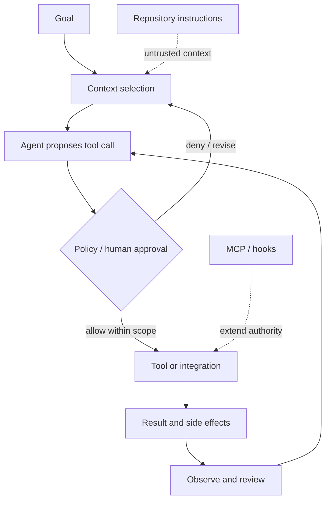

# Lab 02 — Agentic Engineering with Claude

**Type:** Theoretical and hands-on 
**Level:** Intermediate 
**Estimated Duration:** Not stated in the accessible module listing; suggested study time: 60–90 minutes (editorial estimate). 
**Learning Module:** [Agentic Engineering with Claude — Poridhi](https://poridhi.io/lab-group-modules/6a0eb7c3bfa7b7946e2362ab/6a0ec44fbfa7b7946e23661d)

## 1. Introduction

Agentic engineering treats an AI agent as a participant in a software workflow: it receives a goal and context, calls tools, observes results, and may repeat. The engineering task is to design useful authority boundaries, review points, and feedback while keeping tools and data trustworthy. More autonomy can reduce manual steps, but can also increase the impact of a bad instruction, compromised integration, or mistaken action.

The Poridhi module page did not expose its lesson text to this documentation pass. This guide uses the concepts named in the request—workflows, tools, context, permissions, execution boundaries, external integrations, and tool trust—and uses CodexGuard source for implementation claims.

## 2. Lab Overview

The exercises map an agent workflow and its trust edges, then examine how repository instructions, MCP configuration, hooks, permissions, and external systems can affect a task. You will distinguish a review signal from an enforcement control and describe where a human decision belongs.

## 3. Learning Objectives

- Draw the observe/plan/tool/result loop for an agent task.
- Identify tool authority, data access, and external integration trust boundaries.
- Explain how context management affects reliability and prompt-injection exposure.
- Describe least privilege and approval as complementary controls.
- Trace CodexGuard's narrow MCP, hook, instruction, and configuration checks.
- State what CodexGuard does not execute or enforce.

## 4. Prerequisites

- Lab 01 concepts or equivalent understanding of agent context and permissions.
- Poridhi lab access and a disposable sample project.
- Ability to read TOML and basic command-line configuration.
- Use only synthetic tokens and examples; do not start any configured MCP process or hook from the audited fixture.

## 5. Concepts Explained

| Concept | Explanation | Review question |
|---|---|---|
| Agent workflow | A cycle that turns a goal into context gathering, tool calls, observation, and another decision. | Which stages can change files or send data externally? |
| Tool authority | The operations available to the agent, often inherited from the process identity. | Is access read-only, scoped, logged, and revocable? |
| Context management | Selecting relevant files, conversation history, and retrieved material. | Can an untrusted input masquerade as a higher-priority instruction? |
| MCP / external integration | A protocol or service that exposes external tools or data to an agent. | Who supplies the server, what data can it see, and what credentials does it receive? |
| Hook | Configured code or action associated with an event in a host agent. | What triggers it and under whose identity does it run? |
| Human checkpoint | A decision point before an action with meaningful side effects. | Is the reviewer seeing enough context to judge the action? |

An integration is trusted only relative to a task, data set, identity, and update mechanism. Pinning a version or reading a command helps, but does not by itself establish that the service is safe.

## 6. Architecture / Workflow

## 7. Step-by-Step Learning

### Exercise 1 — Map an agent workflow

- **Objective:** Identify where information enters and effects occur.
- **Setup:** Use the Poridhi lab scenario or a fictional code-review task.
- **Instructions:** Draw user goal, repository context, model decision, tools, external services, output, and human approval. Mark file writes, network calls, and credentials separately.
- **Commands:** None are required for this conceptual exercise. Follow the Poridhi lesson's own commands in its isolated lab if applicable.
- **Expected result:** A workflow diagram with at least one explicit trust boundary; its contents depend on your selected scenario.
- **Common mistakes:** Drawing the model as the only actor; omitting ambient process permissions; treating all tool calls as harmless reads.
- **Troubleshooting:** Trace each tool to the identity and resource permissions it actually uses.

### Exercise 2 — Context and instruction trust

- **Objective:** Distinguish trusted task intent from untrusted repository text.
- **Instructions:** Read `fixtures/vulnerable/AGENTS.md` as inert text. Label project guidance, ordinary content, and any suspicious phrase. Compare it with the narrow regex used by `evaluate_text` in [`codexguard/rules.py`](../../codexguard/rules.py). Do not follow or execute the fixture instructions.
- **Expected result:** A short comparison of detected phrase patterns and natural-language variants the rule may miss.
- **Common mistakes:** Assuming one string match proves malicious intent or assuming no match proves safe content.
- **Troubleshooting:** Use the full surrounding paragraph and provenance in manual review; a phrase-only scan intentionally cannot resolve intent.

### Exercise 3 — MCP and hooks as trust edges

- **Objective:** Review integration provenance and authority.
- **Instructions:** Inspect `fixtures/vulnerable/.codex/config.toml` as text. Identify server command/arguments and hook presence. Follow the implementation in `evaluate_config` and describe which shell/inline patterns CG-003 checks and why CG-006 only reports presence. Do not launch the server or hook.
- **Example:** A command array containing `bash`, `-c`, and an inline string is a pattern CodexGuard flags. This is a synthetic example of rule behavior, not a recommendation to run such a command.
- **Expected result:** An integration review table listing source, command, data access, permissions, and update/version control.
- **Common mistakes:** Equating shell use with compromise; granting an integration a real secret to “see if it works.”
- **Troubleshooting:** If the command's effects are unclear, review the upstream implementation in a separate trusted process and sandbox; CodexGuard does not interpret command semantics.

### Exercise 4 — Add review and least-privilege points

- **Objective:** Place approvals before consequential effects.
- **Instructions:** For a sample task, define a read-only discovery phase, proposed change phase, and external side-effect phase. Decide which actions need explicit human review, which should be denied, and what narrow capability would permit a legitimate action.
- **Expected result:** A policy outline tied to specific actions and resources; there is no single CodexGuard policy output.
- **Common mistakes:** Using a single approval prompt as a substitute for process isolation; letting a helper tool inherit broad credentials.
- **Troubleshooting:** Split the workflow into smaller tools or phases and inspect the caller identity.

### Exercise 5 — Audit signals versus enforcement

- **Objective:** Understand CodexGuard's place in a larger workflow.
- **Instructions:** Read [`docs/security-rules.md`](../security-rules.md), then classify each response as advisory, blocking, or remediation. Inspect CLI return handling in [`codexguard/cli.py`](../../codexguard/cli.py): findings return exit code 1, but the CLI itself does not prevent another program from continuing.
- **Expected result:** A diagram that places a human review gate downstream of a report, with the gate supplied by an external process/policy if desired.
- **Common mistakes:** Calling a nonzero CLI exit “automatic blocking”; treating the presence-only hook rule as an unsafe verdict.
- **Troubleshooting:** Check how a calling CI/job uses exit status; CodexGuard alone only reports its result.

## 8. Security Considerations

Threats include indirect prompt injection in project content, excessive permissions, untrusted integration binaries, secret forwarding, unsafe hooks, and confused-deputy behavior through ambient credentials. Reduce context, isolate execution, scope credentials, pin and review integrations, and preserve human control over high-impact actions. False positives and misses are expected in static heuristics.

## 9. Connection to CodexGuard

`codexguard/scanner.py` discovers only `AGENTS.md`, `.codex/config.toml`, `.env.example`, and `.env.*.example`. `codexguard/rules.py:evaluate_config` checks selected sandbox and approval values, certain MCP command shapes, hook presence, and secret patterns; `evaluate_text` checks selected instructions and environment assignments. These rules exist to surface configuration for human review before agent use. They do not start tools, connect to integrations, evaluate effective runtime policy, inspect arbitrary files, or block an agent. CG-003 can flag benign shell wrappers and miss obfuscated alternatives; CG-006 does not analyze hook implementation.

## 10. Practical Takeaways

- An agent workflow inherits trust from each file, tool, process identity, and external service it touches.
- Keep authority small and make consequential effects observable.
- Use CodexGuard as one advisory input to review, not as a CI enforcement system or safety verdict.

## 11. Conclusion

This module turns the agent model from Lab 01 into a system of tools and trust boundaries. Lab 03 shifts focus to process and filesystem isolation with Docker.

## 12. References

- [Poridhi: Agentic Engineering with Claude](https://poridhi.io/lab-group-modules/6a0eb7c3bfa7b7946e2362ab/6a0ec44fbfa7b7946e23661d) — topic details supplied in the project request; lesson body not exposed during this pass.
- [Anthropic: Claude Code overview](https://docs.anthropic.com/en/docs/claude-code/overview)
- [Anthropic: MCP](https://docs.anthropic.com/en/docs/claude-code/mcp)
- [Model Context Protocol: Specification](https://modelcontextprotocol.io/specification/2025-06-18)
- [CodexGuard: Security Rules](../security-rules.md)
- [CodexGuard: Threat Model](../threat-model.md)

---

**Previous Lab:** [01 — Claude Code Fundamentals](lab-01-claude-code-fundamentals.md) · **Learning Path:** [Index](README.md) · **Next Lab:** [03 — Basic Docker Concepts](lab-03-basic-docker-concepts.md)
