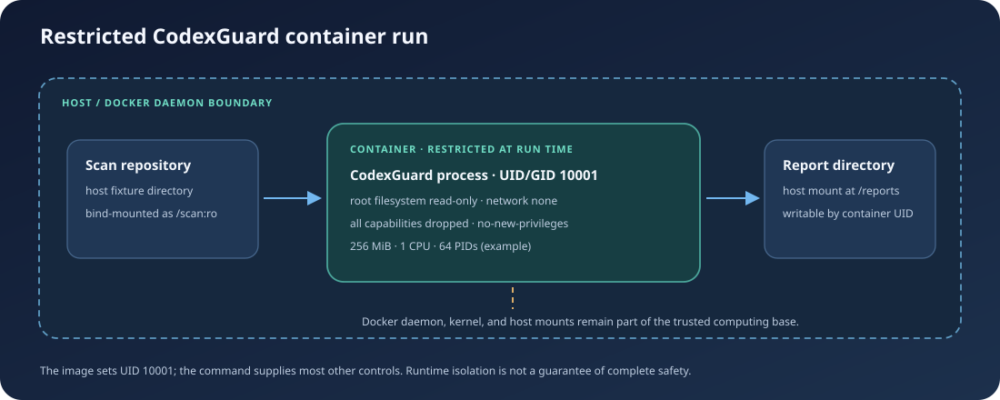
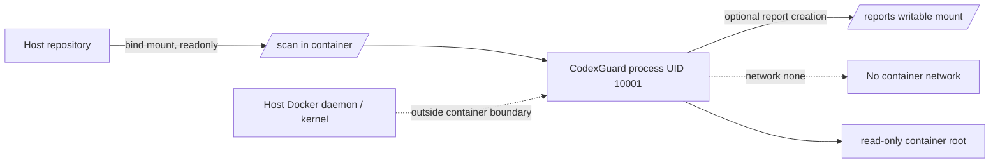

# Lab 03 — Basic Docker Concepts

**Type:** Theoretical and hands-on 
**Level:** Beginner 
**Estimated Duration:** Not available in the supplied Poridhi module listing; suggested study time: 60–90 minutes (editorial estimate). 
**Learning Module:** [Basic Docker Concepts — Poridhi](https://poridhi.io/lab-group-modules/6a0eb7c3bfa7b7946e2362ab/6a0eb821bfa7b7946e2362d3)

## 1. Introduction

Containers package a process and its filesystem view so it can run consistently. They are useful for building and running security tools, but they share the host kernel and rely on the daemon, runtime, and host mount permissions. A container boundary is a set of controls, not proof that arbitrary code is safe.

## 2. Lab Overview

This lab introduces image construction, container lifecycle, networking, bind mounts, users, permissions, and resource controls. It then applies those ideas to the actual CodexGuard Dockerfile and the restricted `docker run` example. Poridhi's exact lesson instructions were not accessible during documentation; commands below come from the repository's Docker guide or are explicitly illustrative.

## 3. Learning Objectives

- Explain an image, a running container, and the container lifecycle.
- Distinguish build-time Dockerfile settings from run-time restrictions.
- Describe container networking, bind mounts, users, and resource controls.
- Explain the read-only scan mount and separate report mount used by CodexGuard.
- Identify host and daemon responsibilities that remain outside container configuration.

## 4. Prerequisites

- Docker Engine or Docker Desktop installed and an understanding of its daemon context.
- A clone of this repository, if reviewing CodexGuard's configuration.
- Synthetic fixtures only. A Docker build executes Dockerfile instructions; inspect the source before building and do not build untrusted images.
- Ensure a separate report directory exists and is writable by the container's numeric user if following the project example.

## 5. Concepts Explained

| Concept | Definition | CodexGuard example |
|---|---|---|
| Image | Built filesystem and metadata used to start containers. | `docker/Dockerfile` copies the package and installs it. |
| Container lifecycle | Create/start, run, stop, remove; container writable layer is generally ephemeral. | `docker run --rm` removes the container when it exits. |
| Network mode | Determines container connectivity and interfaces. | `--network none` disables networking for this invocation. |
| Bind mount | Exposes a host path at a container path. | `/scan` contains input; `/reports` receives requested output. |
| User | UID/GID used by the process in the container. | Dockerfile sets `USER 10001:10001`. |
| Read-only filesystem | Prevents writes to container root filesystem; mounts may have their own modes. | Supplied at runtime with `--read-only`; scan mount independently uses `readonly`. |
| Resource limits | Bound CPU, memory, and process count. | Example flags set 256 MiB, one CPU, and 64 PIDs. |

## 6. Architecture / Workflow

## 7. Step-by-Step Learning

### Exercise 1 — Read the image definition

- **Objective:** Separate image construction from run restrictions.
- **Setup:** Read [`docker/Dockerfile`](../../docker/Dockerfile); do not build it yet.
- **Instructions:** Identify base image and digest, working directory, copied files, package installation, created account, `USER`, `ENTRYPOINT`, and `CMD`. Then classify each item as build time or container metadata.
- **Commands:** `sed -n '1,160p' docker/Dockerfile` displays the Dockerfile on Unix-like systems. It only reads the file.
- **Expected result:** A list showing `python:3.12-slim` by digest and UID/GID `10001:10001`; those values are in the file.
- **Common mistakes:** Assuming a non-root user makes every host mount read-only; treating an image's entrypoint as a sandbox.
- **Troubleshooting:** Check `USER` and `VOLUME` metadata separately from runtime flags and host permissions.

### Exercise 2 — Trace input and output mounts

- **Objective:** Understand which files the container can read or create.
- **Instructions:** In the project command, trace `fixtures/vulnerable` to `/scan` with `readonly`, and `reports` to `/reports` without the read-only flag. Explain why the reporter requires a writable external location only when `--output` is passed.
- **Expected result:** A two-mount diagram; the scan target is mounted read-only and report output is separate. Actual host permission behavior varies by platform.
- **Common mistakes:** Thinking `--read-only` automatically makes every bind mount read-only; using the same directory for input and output.
- **Troubleshooting:** Check the resolved host paths and the container's effective UID. A bind mount's host permissions can still deny report creation.

### Exercise 3 — Review networking and runtime limits

- **Objective:** Read the isolation flags in context.
- **Instructions:** Explain each: `--network none`, `--read-only`, `--cap-drop ALL`, `--security-opt no-new-privileges`, `--memory 256m`, `--cpus 1`, `--pids-limit 64`. Relate them to a network-isolated scan, smaller privilege set, and finite resource budget.
- **Command:** The canonical command is in [`docs/docker-guide.md`](../docker-guide.md). Build and run only if you intend to execute this trusted project configuration.
- **Expected result:** A control-to-purpose table; no specific runtime output is promised here.
- **Common mistakes:** Assuming these flags defeat a vulnerable host kernel, daemon, or mount implementation; forgetting that command exit 1 means findings are expected for the vulnerable fixture.
- **Troubleshooting:** Check support for each option in the local Docker runtime and distinguish CLI rejection from scanner behavior.

### Exercise 4 — Lifecycle and cleanup

- **Objective:** Understand what `--rm` does and what survives the container.
- **Instructions:** Draw container create/run/exit/remove. Identify container-layer state versus bind-mounted report output. Do not delete report data unless you intentionally manage it.
- **Expected result:** A lifecycle diagram that keeps reports on the host-mounted destination after the ephemeral container is removed.
- **Common mistakes:** Treating container removal as cleanup of bind-mounted data.
- **Troubleshooting:** Inspect the run command's mount sources and destinations before use.

## 8. Security Considerations

Use least-privilege container users, read-only inputs, explicit networking policy, dropped capabilities, no-new-privileges, and resource limits where supported. Keep the daemon and host patched; use trusted images; avoid mounting credentials or a full home directory. Resource limits can reduce availability impact but may cause legitimate scans to fail. The root filesystem setting does not replace the read-only scan mount.

## 9. Connection to CodexGuard

[`docker/Dockerfile`](../../docker/Dockerfile) pins a Python 3.12 slim image digest, installs the local package, and configures UID/GID `10001:10001`, with `codexguard` as entrypoint. It does **not** itself set network isolation, read-only root, capabilities, no-new-privileges, CPU/memory/PID limits, or a scan mount. Those are supplied by the documented run command in [`docs/docker-guide.md`](../docker-guide.md): `--network none`, `--read-only`, `--cap-drop ALL`, `no-new-privileges`, 256 MiB, one CPU, PID limit 64, and a read-only `/scan` bind mount. `/reports` is a separate writable mount for explicit output. The setup exists to reduce the auditor process's runtime authority. It depends on host/daemon behavior and does not alter scanner coverage or guarantee complete isolation.

## 10. Practical Takeaways

- The image configures identity; the operator configures many runtime restrictions.
- Read-only root and read-only input are separate controls.
- A writable report mount is an explicit output channel and should be protected.
- Containerization adds a boundary but does not certify the application or host.

## 11. Conclusion

This lab explains the exact local container profile used by CodexGuard. Lab 04 moves from container isolation to cloud identities and compute boundaries.

## 12. References

- [Poridhi: Basic Docker Concepts](https://poridhi.io/lab-group-modules/6a0eb7c3bfa7b7946e2362ab/6a0eb821bfa7b7946e2362d3) — module page supplied; detailed lesson body unavailable here.
- [Docker: What is a container?](https://docs.docker.com/get-started/docker-concepts/the-basics/what-is-a-container/)
- [Docker: Networking overview](https://docs.docker.com/engine/network/)
- [Docker: Run containers](https://docs.docker.com/engine/containers/run/)
- [CodexGuard: Docker Guide](../docker-guide.md)

---

**Previous Lab:** [02 — Agentic Engineering with Claude](lab-02-agentic-engineering-with-claude.md) · **Learning Path:** [Index](README.md) · **Next Lab:** [04 — AWS Basics](lab-04-aws-basics.md)
