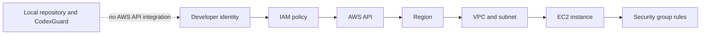

# Lab 04 — AWS Basics

**Type:** Theoretical and hands-on 
**Level:** Beginner 
**Estimated Duration:** Not available in the supplied Poridhi module listing; suggested study time: 60–90 minutes (editorial estimate). 
**Learning Module:** [AWS Basics — Poridhi](https://poridhi.io/lab-group-modules/6a0eb7c3bfa7b7946e2362ab/6a0eb8564a49372ba794ead8)

## 1. Introduction

Cloud security concerns the identities, infrastructure, network paths, and managed services that host an application. Repository security concerns source/configuration and developer workflows. They overlap when credentials or code cross the boundary, but they are not the same control plane. CodexGuard audits selected local repository files; it does not connect to AWS or assess a cloud account.

## 2. Lab Overview

The module topics provided for this task are AWS fundamentals, Regions, IAM, EC2, security groups, cloud infrastructure, access management, and cloud security. The lesson page body was not available during this documentation pass, so the exercises use read-oriented AWS concepts and explicitly avoid claiming a Poridhi-specific command sequence.

## 3. Learning Objectives

- Explain Regions and why resource location affects design and governance.
- Distinguish an IAM identity/policy from a network security group.
- Describe the role of EC2 and instance identity.
- Identify why public exposure and long-lived credentials require careful review.
- Place local repository auditing in a wider developer and cloud security workflow.

## 4. Prerequisites

- Poridhi lab access; an AWS account only if the module requires one.
- AWS CLI only for optional read-only inventory exercises; configure it using a protected identity and never commit credentials.
- Awareness that AWS actions can create billable resources. This guide's optional commands are describe/read calls; do not run creation or deletion commands without a reviewed lab plan.

## 5. Concepts Explained

| Concept | Purpose | Security concern |
|---|---|---|
| Region | Geographic collection of AWS resources. | Data residency, latency, service availability, and cross-region access. |
| IAM user/role/policy | Identity and permissions for AWS API actions. | Excess permissions and long-lived credentials. Prefer task-scoped role credentials when available. |
| EC2 | Virtual machine service. | Instance patching, metadata/role access, exposed services, and image provenance. |
| Security group | Stateful virtual firewall attached to network interfaces/resources. | Broad inbound rules can expose management or application ports. |
| Shared responsibility | AWS secures underlying cloud infrastructure; customers configure identities, data, operating systems, and workloads according to service model. | The split differs by service and does not remove customer configuration duties. |

## 6. Architecture / Workflow

The final dashed connection indicates workflow context only: CodexGuard does not call AWS APIs.

## 7. Step-by-Step Learning

### Exercise 1 — Identify the cloud boundary

- **Objective:** Separate a local repository from deployed cloud resources.
- **Setup:** Read the Poridhi module overview and use its lab account if provided.
- **Instructions:** Draw laptop/repository, Git remote, CI, AWS account, Region, IAM, and EC2. Mark where source, reports, credentials, and network traffic cross.
- **Commands:** None required for the diagram.
- **Expected result:** A trust-boundary diagram. The resource set depends on the actual lesson environment.
- **Common mistakes:** Assuming a repository scanner sees deployed instance settings; putting cloud secret values into an audit example.
- **Troubleshooting:** Label each component by control plane: Git, local OS, CI, AWS IAM, or VPC.

### Exercise 2 — Inspect the active identity safely

- **Objective:** Understand which identity an AWS CLI call would use.
- **Setup:** Optional; AWS CLI and a lab-provided identity with read-only permissions. Do not use personal production credentials.
- **Command:** `aws sts get-caller-identity` asks AWS STS for identity metadata associated with the current credentials. It makes a network request and requires valid authentication; it does not create infrastructure.
- **Expected result:** An account and principal identity response if the request is authorized. Do not publish account IDs or principal names in screenshots.
- **Common mistakes:** Sharing access keys, assuming a shell profile uses the expected role, or treating a successful identity response as evidence that permissions are minimal.
- **Troubleshooting:** Use the Poridhi environment's credential instructions; if access is denied, inspect the assigned role/policy with the instructor rather than switching to an administrator identity.

### Exercise 3 — Understand Region and EC2 inventory

- **Objective:** Relate selected Region and compute inventory to exposure.
- **Optional command:** `aws ec2 describe-instances --region REGION` is a read-only EC2 inventory call; replace `REGION` with an authorized lab Region. It returns data only if the identity can describe instances.
- **Instructions:** Review instance state, image, attached security groups, and role association using the lab's permitted console/CLI. Do not change rules or launch resources for this guide.
- **Expected result:** A small inventory note identifying what is visible and which access is required; actual output varies.
- **Common mistakes:** Assuming a private IP alone makes a service safe; ignoring metadata credentials available to a process on an instance.
- **Troubleshooting:** Check Region selection and IAM `DescribeInstances` permission; avoid pasting full account or network identifiers publicly.

### Exercise 4 — Review IAM and security groups separately

- **Objective:** Distinguish API authorization from packet filtering.
- **Instructions:** For a hypothetical EC2 task, list the IAM actions the process requires and the network flows the service requires. Keep the policies and inbound rules as narrow as practical. Never open SSH (`22`) to all addresses as a convenience.
- **Expected result:** Two separate least-privilege tables, one for identity and one for network flows.
- **Common mistakes:** Treating a security group as an IAM policy or treating IAM as a firewall.
- **Troubleshooting:** Trace denied API calls to IAM and blocked connections to route/security-group/network policy layers.

## 8. Security Considerations

Use least-privilege roles, short-lived credentials where possible, protected secret storage, restricted inbound rules, patched images, and explicit logging. Avoid public administrative access. Review account and Region selection before cloud changes. AWS inventory output can reveal internal network topology and should be handled as sensitive metadata even when it contains no credentials.

## 9. Connection to CodexGuard

There is **no direct AWS implementation** in the current repository. CodexGuard has no AWS SDK dependency, API client, IAM policy parser, EC2 inventory, or cloud deployment configuration. Its `codexguard/scanner.py` reads selected files in an explicit local directory; it can flag a secret-like value in supported files (CG-005) but cannot inspect AWS account state or validate an IAM role. It fits before agent interaction and alongside CI/cloud reviews, not in place of them. The limitation is that local repository findings say nothing about deployed infrastructure, and cloud configuration findings may not exist in the scanned files.

## 10. Practical Takeaways

- Repository and cloud security are distinct layers with credential and deployment handoffs between them.
- IAM controls API authority; security groups control network traffic.
- Review identity and Region before inventory or modification.
- CodexGuard is a local repository auditor, not an AWS security scanner.

## 11. Conclusion

This module adds cloud identity and compute concepts to the local agent and container boundaries. Lab 05 returns to container deployment composition, where multiple services and mounts are described together.

## 12. References

- [Poridhi: AWS Basics](https://poridhi.io/lab-group-modules/6a0eb7c3bfa7b7946e2362ab/6a0eb8564a49372ba794ead8) — topic scope supplied in the request; exact lesson steps unavailable here.
- [AWS: What is IAM?](https://docs.aws.amazon.com/IAM/latest/UserGuide/introduction.html)
- [AWS: What is Amazon EC2?](https://docs.aws.amazon.com/AWSEC2/latest/UserGuide/concepts.html)
- [AWS: Security groups](https://docs.aws.amazon.com/vpc/latest/userguide/vpc-security-groups.html)
- [CodexGuard: Threat Model](../threat-model.md)

---

**Previous Lab:** [03 — Basic Docker Concepts](lab-03-basic-docker-concepts.md) · **Learning Path:** [Index](README.md) · **Next Lab:** [05 — Docker Compose](lab-05-docker-compose.md)
