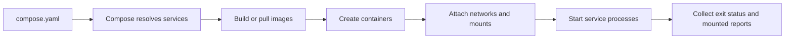

# Lab 05 — Docker Compose

**Type:** Theoretical and hands-on<br>
**Level:** Beginner to intermediate<br>
**Estimated Duration:** Not stated in the supplied Poridhi listing; suggested study time: 60–90 minutes (editorial estimate).<br>
**Learning Module:** [Docker Compose — Poridhi](https://poridhi.io/lab-group-modules/6a0eb7c3bfa7b7946e2362ab/6a0eb847bfa7b7946e2362f0)

## 1. Introduction

Docker Compose describes a multi-container application in a YAML file: services, images/build contexts, networks, mounts, environment, and dependencies. It makes a local deployment repeatable, but a manifest is executable deployment configuration in practice. Review it before running `up`, especially when it builds images, mounts host data, or injects environment values.

## 2. Lab Overview

The topics supplied for this module include services, dependencies, networking, volumes, environment variables, configuration, orchestration, and isolation. This guide uses an illustrative single-service CodexGuard configuration to explain the concepts. **There is no Compose file in the current CodexGuard repository.** The Poridhi lesson body could not be read, so its exact service architecture and exercise commands are not represented as facts.

## 3. Learning Objectives

- Explain services, dependencies, project networks, bind mounts, and named volumes.
- Read Compose environment and command configuration without confusing it with scanner settings.
- Evaluate what a service can access through its user, mounts, and network.
- Understand how Compose can package a CLI workflow without claiming the project already uses Compose.

## 4. Prerequisites

- Basic Docker concepts (Lab 03) and a Docker Compose plugin.
- A source tree you have reviewed before building it.
- A writable report directory and synthetic input fixture.
- Do not put real credentials in YAML or an untracked `.env` file that could be committed.

## 5. Concepts Explained

| Compose concept | Meaning | Security review |
|---|---|---|
| Service | A container workload described under `services`. | What image/command runs and as which user? |
| Dependency | Startup/health relationship between services. | Does startup order imply readiness or trust? Usually not by itself. |
| Network | Service connectivity; Compose creates a project network by default. | Which peers and external endpoints can communicate? |
| Bind mount / volume | Host path or managed storage made available in a service. | Is it read-only? Does it expose home directories or secrets? |
| Environment | Values passed to a process. | Are values secret? Avoid baking secrets into images or tracked manifests. |
| Resource controls | CPU, memory, process limits where supported. | Are they configured and enforced by the target runtime? |

## 6. Architecture / Workflow



This is the general Compose workflow. The CodexGuard repository does not currently define `compose.yaml`.

## 7. Step-by-Step Learning

### Exercise 1 — Read a Compose model

- **Objective:** Identify service lifecycle and dependency declarations.
- **Setup:** Use the Poridhi lesson's multi-container example or inspect the illustrative service below.
- **Instructions:** Mark image/build source, command, `depends_on`, networks, volumes, environment, health checks, user, and resource constraints. Ask which settings are defaults versus explicitly constrained.
- **Expected result:** A service graph and a host/container access table; exact lab topology depends on Poridhi's environment.
- **Common mistakes:** Assuming `depends_on` means an application is ready; assuming all services need network access.
- **Troubleshooting:** Read the Compose specification for the exact field semantics and runtime support.

### Exercise 2 — Illustrative isolated CodexGuard service

The following is a **teaching example only**; no `compose.yaml` is committed in this repository. Review it before using. `build` executes the Dockerfile, and `up --build` must not be used with untrusted source.

```yaml
services:
  audit:
    build:
      context: .
      dockerfile: docker/Dockerfile
    user: "10001:10001"
    command: ["scan", "/scan", "--format", "json", "--output", "/reports/audit.json"]
    network_mode: "none"
    read_only: true
    cap_drop: ["ALL"]
    security_opt:
      - "no-new-privileges:true"
    mem_limit: 256m
    cpus: 1.0
    pids_limit: 64
    volumes:
      - ./fixtures/vulnerable:/scan:ro
      - ./reports:/reports
```

This example assumes the Compose file is placed at the repository root. The report mount directory must already exist and be writable by the configured UID. Compose implementations and host bind-mount permissions can vary.

- **Instructions:** For each setting, explain what authority it removes or adds. Explain why the report mount is writable while input is read-only. Compare against `docs/docker-guide.md`.
- **Commands:** `docker compose config` renders/validates the Compose model; `docker compose up --build` builds and starts it. These are illustrative only and have not been run. Building executes the Dockerfile.
- **Expected result:** A reviewed configuration model. The vulnerable fixture's previously documented scan result is 8 findings / exit 1, but this Compose example is not recorded as tested.
- **Common mistakes:** Saving reports inside `/scan`; incorrect relative build context; using secrets through cleartext environment fields; expecting `network_mode: none` to allow service-name networking.
- **Troubleshooting:** Check project-root-relative mount paths, directory ownership, and Compose CLI validation output. Do not make `/scan` writable to “fix” report output.

### Exercise 3 — Multi-service trust review

- **Objective:** Examine dependencies and communication paths.
- **Instructions:** In the Poridhi lab's multi-service example, draw service-to-service edges and identify which service actually needs each network. Review every shared volume and environment value. Do not add an unnecessary service to the CodexGuard example: this CLI has no database or API service.
- **Expected result:** A graph showing service identities, networks, and mounted data.
- **Common mistakes:** Treating every service in the default network as isolated from every other service; assuming named volumes are read-only by default.
- **Troubleshooting:** Check Compose network membership and mount mode explicitly; remove unused permissions and ports.

### Exercise 4 — Teardown and state

- **Objective:** Distinguish container lifecycle from persistent data lifecycle.
- **Instructions:** Review `docker compose down` and named-volume cleanup behavior in official documentation before using any volume-removal flag. Identify which report and source files are bind-mounted and therefore remain on the host.
- **Expected result:** A state inventory covering container layer, bind mounts, and named volumes.
- **Common mistakes:** Deleting persistent volumes without checking contents or assuming container deletion erases host-mounted data.
- **Troubleshooting:** List mounts and inspect the Compose project name before cleanup.

## 8. Security Considerations

Compose files can expose host paths, credentials, service ports, and broad network reachability. Use least privilege per service, avoid secrets in tracked YAML, mount only needed paths, prefer read-only inputs, and restrict network membership. Pin image references where appropriate and review build contexts. `network_mode: none` is suitable only when the service has no network dependency; it is a deployment choice, not a CodexGuard code property.

## 9. Connection to CodexGuard

The actual project has a single [`docker/Dockerfile`](../../docker/Dockerfile) and a documented restricted `docker run` example, but no Compose manifest, multi-container services, inter-service dependencies, Compose networks, or Compose volumes. Compose could describe the existing CLI as one service and make settings repeatable; that is a possible future deployment, not implemented behavior. The scanner itself remains a single local CLI and does not orchestrate containers.

## 10. Practical Takeaways

- Compose makes service topology declarative; the declared topology still needs security review.
- Mounts, environment, and network membership define practical authority.
- CodexGuard's existing Docker invocation is a one-container example, not Compose support.

## 11. Conclusion

This lab explains how a CLI might be packaged consistently with Compose. Lab 06 looks at workflow automation and the repository's actual GitHub Actions files.

## 12. References

- [Poridhi: Docker Compose](https://poridhi.io/lab-group-modules/6a0eb7c3bfa7b7946e2362ab/6a0eb847bfa7b7946e2362f0) — module scope supplied in the request; lesson body unavailable here.
- [Docker Docs: Compose services](https://docs.docker.com/reference/compose-file/services/)
- [Docker Docs: Compose networking](https://docs.docker.com/compose/how-tos/networking/)
- [Docker Docs: Compose file reference](https://docs.docker.com/reference/compose-file/)
- [CodexGuard: Docker Guide](../docker-guide.md)

---

**Previous Lab:** [04 — AWS Basics](lab-04-aws-basics.md) · **Learning Path:** [Index](README.md) · **Next Lab:** [06 — GitHub Actions with Docker](lab-06-github-actions-with-docker.md)
