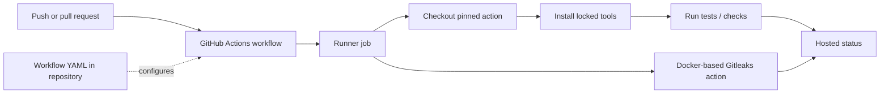

# Lab 06 — GitHub Actions with Docker

**Type:** Theoretical and hands-on 
**Level:** Intermediate 
**Estimated Duration:** Not available in the supplied module listing; suggested study time: 60–90 minutes (editorial estimate). 
**Learning Module:** [GitHub Actions with Docker — Poridhi](https://poridhi.io/lab-group-modules/6a0eb7c3bfa7b7946e2362ab/6a0eb87f4a49372ba794eaf3)

## 1. Introduction

CI/CD workflows automatically run repository-defined jobs when events such as pushes and pull requests occur. Docker can package tools or services for those jobs. Because workflow YAML controls code execution and token permissions, reviewing the workflow is part of repository security. A workflow file is configuration, not evidence that a hosted run passed.

## 2. Lab Overview

This guide covers CI/CD concepts, GitHub Actions triggers, jobs, steps, Docker in CI, token permissions, secrets, checks, and workflow hardening. It then documents the exact CodexGuard workflow definitions present in `.github/workflows/`. The supplied Poridhi module page did not expose lesson-specific instructions; module scope comes from the request.

## 3. Learning Objectives

- Read an Actions workflow from trigger through job, runner, steps, and outputs.
- Understand `GITHUB_TOKEN` permissions and why least privilege matters.
- Distinguish a Docker-based action from a Docker command run in a job.
- Explain secret exposure and untrusted pull-request risks.
- Describe what CodexGuard's two workflows configure without claiming a successful hosted run.

## 4. Prerequisites

- Git/GitHub and YAML fundamentals.
- A repository you are authorized to inspect; no GitHub token is needed to read workflow files locally.
- Docker familiarity for the `security-checks.yml` Gitleaks container action.
- Do not expose Actions secrets in logs or attach secrets to untrusted code execution.

## 5. Concepts Explained

| Term | Meaning | Review point |
|---|---|---|
| Workflow | YAML automation definition under `.github/workflows`. | Who can change it and what events run it? |
| Trigger | Event such as push or pull request. | Can untrusted code influence the workflow? |
| Job / runner | Group of steps on a hosted or self-hosted machine. | What machine state and network are available? |
| Step / action | Shell command or reusable action. | Is the action pinned and trusted? What token can it use? |
| `GITHUB_TOKEN` permissions | Workflow-scoped authorization. | Grant the minimum permissions needed; explicitly set them. |
| Secret | Protected value injected into a job. | Can fork/untrusted PR code access it or print it? |
| Docker action | Action packaged as a Docker image, separate from a `docker run` shell step. | Is the image pinned and is its input/output understood? |

## 6. Architecture / Workflow

This describes the repository's intended automation flow. Hosted job success must be checked on GitHub for a particular commit.

## 7. Step-by-Step Learning

### Exercise 1 — Inspect triggers and permissions

- **Objective:** Learn when a workflow runs and what token access it requests.
- **Setup:** Read both `.github/workflows/tests.yml` and `.github/workflows/security-checks.yml` as text.
- **Instructions:** Record triggers, workflow-level permissions, job-level permissions, runners, Python versions, and checkout options. Both files declare push/pull_request triggers and `contents: read`; checkout actions have `persist-credentials: false` and are pinned by full commit SHA in the checked-in definitions.
- **Commands:** `sed -n '1,220p' .github/workflows/tests.yml` and the corresponding command for `security-checks.yml` are read-only file inspection.
- **Expected result:** A workflow inventory consistent with the YAML. Do not infer run status.
- **Common mistakes:** Assuming a top-level permission means no job can request more; forgetting action code runs with the job's available context.
- **Troubleshooting:** Check job-level permission blocks and the action's version reference.

### Exercise 2 — Trace the test workflow

- **Objective:** Understand its runtime matrix and work performed.
- **Instructions:** Read `tests.yml`: matrix Python `3.11`, `3.12`, `3.13`, `3.14`; hashed development lock installation; package installation; pytest; CLI checks; vulnerable and hardened fixture scans. Findings from the vulnerable fixture are expected and the workflow checks exit code 1.
- **Expected result:** A step diagram and a note that this is repository configuration, not a hosted result.
- **Common mistakes:** Treating the matrix declaration as evidence that all versions passed; treating fixture findings as a job failure (workflow explicitly expects status 1).
- **Troubleshooting:** On GitHub, inspect run/job logs for a commit SHA; do not substitute historical local results.

### Exercise 3 — Trace security checks and Docker usage

- **Objective:** Identify the external tools and container action.
- **Instructions:** Read `security-checks.yml`. Note Python 3.12, locked installs, Ruff, Bandit, three pip-audit targets, and Gitleaks `docker://` images pinned by digest for working-tree and history scans. Check the config file referenced by Gitleaks.
- **Expected result:** Security job map based on the workflow text; no checks are executed by this reading exercise.
- **Common mistakes:** Calling the repository's CodexGuard scanner a GitHub Action; treating the Gitleaks Docker action as the CodexGuard runtime container; assuming dependency installation is offline.
- **Troubleshooting:** Verify image/action provenance and digest, lock files, and workflow permissions when maintaining CI.

### Exercise 4 — Design a safe change review

- **Objective:** Reason about workflow changes and untrusted contribution code.
- **Instructions:** For a proposed workflow edit, ask who can trigger it, whether code from a fork is executed, whether secrets are available, which token scopes are needed, whether third-party actions are pinned, and what artifacts/logs may reveal.
- **Expected result:** A checklist tied to the changed workflow. No specific hosted result is expected.
- **Common mistakes:** Printing secret environment variables for debugging; using write permissions by default; running untrusted code in a privileged event context.
- **Troubleshooting:** Reduce permissions and split jobs so untrusted code does not share secrets or write-capable tokens.

### Exercise 5 — Place CodexGuard in CI conceptually

- **Objective:** Distinguish existing checks from a potential future CI audit.
- **Instructions:** The current workflows run CodexGuard against its fixtures through the tests workflow; they do **not** invoke CodexGuard on arbitrary PR repository content as a standalone gate. Sketch what an explicit scan job would need: root selection, report handling, exit-code policy, secrets protection, and bounded runtime. Do not add a workflow as part of this learning exercise.
- **Expected result:** A proposed design with an explicit policy owner and manual interpretation for heuristic findings.
- **Common mistakes:** Assuming exit code 1 automatically blocks Codex or provides assurance; writing reports into the scanned tree.
- **Troubleshooting:** Review the caller's status handling and ensure report destinations are separate from scan roots.

## 8. Security Considerations

Workflow edits can create supply-chain and credential-exposure paths. Pin third-party actions to reviewed immutable references, minimize `GITHUB_TOKEN` permissions, restrict secrets, avoid untrusted code in privileged contexts, and protect self-hosted runner state. A Docker action still receives inputs and permissions from its job. CI checks are evidence only for the workflows and commit that actually ran.

## 9. Connection to CodexGuard

The actual workflows are [`tests.yml`](../../.github/workflows/tests.yml) and [`security-checks.yml`](../../.github/workflows/security-checks.yml). They trigger on push and pull request and declare read-only `contents` permission. Tests use a Python 3.11–3.14 matrix, locked development dependencies, pytest, CLI/fixture checks. Security checks use Python 3.12, Ruff, Bandit, pip-audit, and digest-pinned Gitleaks containers. These workflows validate this repository's code and selected fixtures; they do not define a reusable GitHub Action or automatically scan arbitrary consumers' repositories. This guide makes no claim of hosted success; check the Actions page for a specific commit.

## 10. Practical Takeaways

- Workflow YAML is executable automation and deserves code review.
- Triggers, token permissions, action provenance, and secrets form a security boundary.
- A configured CI matrix is not the same as a completed run.
- CodexGuard's findings are not automatically enforced by GitHub Actions in this repository.

## 11. Conclusion

This lab connects source review to automated checks and deployment identity. Lab 07 extends the boundary model to routed networks and cloud subnets.

## 12. References

- [Poridhi: GitHub Actions with Docker](https://poridhi.io/lab-group-modules/6a0eb7c3bfa7b7946e2362ab/6a0eb87f4a49372ba794eaf3) — module topic supplied; lesson body unavailable during this pass.
- [GitHub: Workflow syntax](https://docs.github.com/en/actions/reference/workflows-and-actions/workflow-syntax)
- [GitHub: Security hardening for Actions](https://docs.github.com/en/actions/security-for-github-actions/security-guides/security-hardening-for-github-actions)
- [CodexGuard: Tests and Fixtures](../tests-and-fixtures.md)
- [CodexGuard: Project Status](../project-status.md)

---

**Previous Lab:** [05 — Docker Compose](lab-05-docker-compose.md) · **Learning Path:** [Index](README.md) · **Next Lab:** [07 — AWS Networking](lab-07-aws-networking.md)
