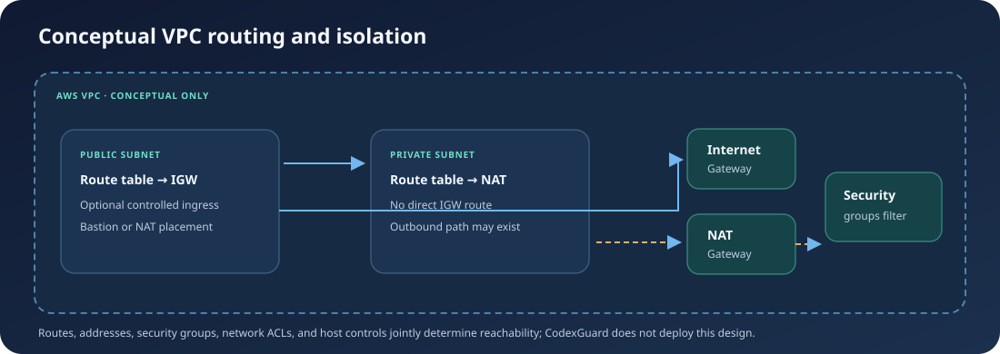
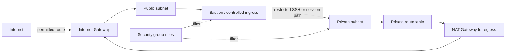

# Lab 07 — AWS Networking

**Type:** Theoretical and hands-on 
**Level:** Intermediate 
**Estimated Duration:** Not stated in the supplied Poridhi module listing; suggested study time: 75–100 minutes (editorial estimate). 
**Learning Module:** [AWS Networking — Poridhi](https://poridhi.io/lab-group-modules/6a0eb7c3bfa7b7946e2362ab/6a0ec4544a49372ba794ed34)

## 1. Introduction

Network architecture determines which workloads can communicate and how traffic reaches public or private destinations. In cloud environments, a VPC, subnet routes, gateways, security groups, and SSH access combine to form an effective boundary. AI-assisted development environments also need explicit network decisions: unrestricted egress may permit data exfiltration or unreviewed tool access.

CodexGuard does not deploy to AWS. Its optional Docker invocation sets `--network none` for the scanner container. This is a local runtime control, not a VPC configuration.

## 2. Lab Overview

The topics supplied are VPCs, public/private subnets, route tables, Internet Gateway, NAT Gateway, bastion host, security groups, SSH, and network isolation. The Poridhi lesson body was not exposed in the supplied module page. This guide gives a conceptual route walkthrough and read-only inventory options; it does not invent the lab's CIDRs, account resources, or expected output.

## 3. Learning Objectives

- Explain how VPC CIDRs and subnets define address and routing domains.
- Trace a route from a subnet through a route table and gateway.
- Distinguish public reachability, outbound NAT, and a security-group allowance.
- Describe bastion/SSH risks and safer administrative access patterns.
- Relate network isolation to offline scanners and coding-agent environments.
- State clearly that CodexGuard has no AWS network integration.

## 4. Prerequisites

- Basic IP/CIDR and routing concepts; AWS fundamentals (Lab 04).
- Poridhi's isolated networking lab. An AWS account and CLI are optional and only required if its exercises ask for them.
- For optional inventory commands, a lab identity with read-only `Describe*` permissions.
- Do not create NAT gateways, EC2 instances, public IPs, or SSH ingress for this guide; those can incur cost or create exposure.

## 5. Concepts Explained

| Concept | Role | Security consideration |
|---|---|---|
| VPC | Isolated, logically defined network with address ranges. | CIDR overlap and routes determine reachable peers. |
| Subnet | Address range in one Availability Zone associated with a route table. | “Public” usually means a route to an Internet Gateway; instances also need addressing and permissive controls. |
| Route table | Destination-to-target routes associated with subnets. | Keep routes minimal; inspect default routes and transit paths. |
| Internet Gateway (IGW) | Connects a VPC to the internet when routes and addressing permit. | An IGW attachment alone does not make every resource reachable. |
| NAT Gateway | Permits outbound connectivity from private subnet workloads through a managed NAT path; does not by itself provide unsolicited inbound reachability. | Egress is still a data path; constrain destinations where possible and account for cost. |
| Security group | Stateful allow rules on network interfaces/resources. | Avoid broad inbound management ports; security groups do not replace IAM. |
| Bastion / SSH | Administrative access path, often through a hardened intermediary. | Public SSH expands attack surface; use restricted source ranges, short-lived access, or managed session alternatives. |

## 6. Architecture / Workflow

This is a conceptual pattern. Actual connectivity depends on routes, addressing, security groups, network ACLs, host firewalls, and IAM/access controls.

## 7. Step-by-Step Learning

### Exercise 1 — Sketch the VPC

- **Objective:** Distinguish address boundaries from routes.
- **Setup:** Use the Poridhi module's diagram or sample VPC. Do not create new resources for this guide.
- **Instructions:** Mark VPC CIDR, Availability Zones, subnet CIDRs, route-table association, local route, gateways, and security groups. Identify whether each subnet can receive inbound traffic or only initiate outbound paths.
- **Commands:** None required for a conceptual diagram.
- **Expected result:** A network map consistent with the lab topology; no CIDR values are prescribed here.
- **Common mistakes:** Calling a subnet private solely because it lacks a public IP; ignoring default routes or IPv6 routes.
- **Troubleshooting:** Trace the route table association and matching destination to target, then inspect all additional filters.

### Exercise 2 — Trace internet ingress and egress

- **Objective:** Follow packets through routing controls.
- **Instructions:** Trace a hypothetical inbound HTTPS flow to a public service and a private instance's outbound package-download flow. For each, identify route, gateway, IP addressing, and stateful allow rules. Then trace a flow that should be denied.
- **Expected result:** Three path diagrams and a list of required controls; no actual network flow is launched.
- **Common mistakes:** Treating an IGW or NAT Gateway as an access-control policy; forgetting that a public subnet route needs compatible addressing and security rules.
- **Troubleshooting:** Check subnet route table, subnet-to-table association, target state, address assignment, security groups, network ACLs, and host rules.

### Exercise 3 — Review bastion and SSH access

- **Objective:** Reduce administrative exposure.
- **Instructions:** In the lab design, identify where SSH terminates, which source ranges are allowed, and what identity authenticates. Compare a public bastion to a managed session option if the lesson covers one. Do not open port 22 to `0.0.0.0/0`.
- **Expected result:** A short access diagram and a least-privilege inbound rule description, not a live security-group change.
- **Common mistakes:** Reusing static private keys, leaving a bastion unpatched, allowing access from everywhere, or assuming private subnets need no egress controls.
- **Troubleshooting:** Verify route, security-group source, key/identity, OS firewall, and the target's authorized session path.

### Exercise 4 — Optional read-only inventory

- **Objective:** Compare a declared network diagram with account state.
- **Setup:** AWS CLI and a read-only Poridhi lab identity. Commands make network API requests and may return sensitive topology; keep output private.
- **Commands:** `aws ec2 describe-vpcs --region REGION`, `aws ec2 describe-subnets --region REGION`, and `aws ec2 describe-route-tables --region REGION` request read-only inventory. `REGION` is a placeholder; use the assigned lab Region.
- **Expected result:** Resource descriptions if authorized. Actual account results vary and should not be pasted into public documentation.
- **Common mistakes:** Using a production identity, confusing credentials errors with missing resources, or invoking create/modify commands during an inventory exercise.
- **Troubleshooting:** Confirm the selected role and Region with the instructor; request only read permissions needed for the lab.

### Exercise 5 — Compare AWS networking with local scanner isolation

- **Objective:** Relate egress boundaries to security-tool design.
- **Instructions:** Read the Docker command in [`docs/docker-guide.md`](../docker-guide.md). Compare `--network none` with an AWS private subnet lacking an external route. Note that these operate at different layers and have different host/control-plane assumptions.
- **Expected result:** A comparison table covering scope, enforcement layer, operator, and residual risk.
- **Common mistakes:** Claiming the CodexGuard Python code itself configures host or VPC networking; assuming offline behavior from code removes the value of runtime network isolation.
- **Troubleshooting:** Separate application behavior, container namespace/network mode, host networking, and cloud route policy.

## 8. Security Considerations

Keep network paths narrow and observable. Avoid public administrative access, expose only required application ports, protect instance identities, and review egress as well as ingress. NAT enables outbound flows but does not make them harmless. Bastions become sensitive entry points. A private subnet is not equivalent to no network. For agent environments, restrict access to untrusted network destinations and keep secrets out of unrestricted tools.

## 9. Connection to CodexGuard

No VPC, subnet, route-table, gateway, EC2, SSH, or AWS security-group code exists in this repository. CodexGuard's offline scan path uses local filesystem operations in `codexguard/scanner.py`; it makes no network requests as part of scanning according to its source and tests. The Docker example independently adds `--network none` to the scanner container, as documented in `docs/docker-guide.md`. This mitigates network access from that container invocation but depends on Docker/runtime behavior and does not configure the host, VPC, or entire development machine.

## 10. Practical Takeaways

- Effective reachability is the combination of addressing, routing, network filters, and process identity.
- A NAT path is outbound connectivity, not a universal security boundary.
- Network isolation is useful for audit tools and agent sandboxes but belongs to a different layer than application logic.
- CodexGuard is a local repository auditor; it is neither an AWS deployment nor a VPC scanner.

## 11. Conclusion

This module completes the infrastructure sequence by connecting routing paths to trust boundaries. Together, the seven labs provide context for CodexGuard's narrow role: report selected local repository signals while leaving deeper runtime and cloud decisions to people and their other controls.

## 12. References

- [Poridhi: AWS Networking](https://poridhi.io/lab-group-modules/6a0eb7c3bfa7b7946e2362ab/6a0ec4544a49372ba794ed34) — supplied topic scope; exact module lesson body unavailable here.
- [AWS: Subnet route tables](https://docs.aws.amazon.com/vpc/latest/userguide/subnet-route-tables.html)
- [AWS: Add internet access to a subnet](https://docs.aws.amazon.com/vpc/latest/userguide/working-with-igw.html)
- [AWS: VPC infrastructure security](https://docs.aws.amazon.com/vpc/latest/userguide/infrastructure-security.html)
- [Docker: Compose networking, `none` mode](https://docs.docker.com/compose/how-tos/networking/)
- [CodexGuard: Security Model](../security-model.md)

---

**Previous Lab:** [06 — GitHub Actions with Docker](lab-06-github-actions-with-docker.md) · **Learning Path:** [Index](README.md) · **Next Lab:** None
