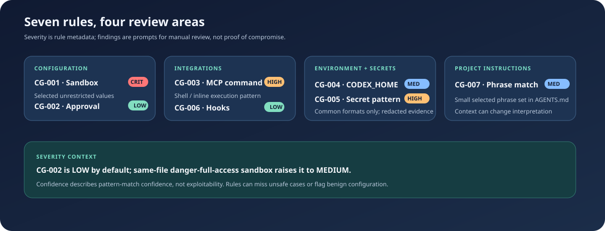

# Security Rules Reference

CodexGuard has seven heuristic rules. This page describes the implementation in [`codexguard/rules.py`](../codexguard/rules.py) and rule metadata in [`rules/security_rules.json`](../rules/security_rules.json). The bundled catalog at [`codexguard/security_rules.json`](../codexguard/security_rules.json) carries the same rule metadata. These rules identify patterns for review; they do not prove compromise, enforce policy, or establish that an unmatched repository is safe.

## At a glance

| ID | Rule | Default severity | Evaluator |
|---|---|---:|---|
| CG-001 | Dangerous Sandbox Configuration | CRITICAL | `evaluate_config` |
| CG-002 | No-Prompt Approval Policy | LOW; conditionally MEDIUM | `evaluate_config` |
| CG-003 | Suspicious MCP Configuration | HIGH | `evaluate_config` |
| CG-004 | CODEX_HOME Redirection | MEDIUM | `evaluate_text` for environment examples |
| CG-005 | Potential Secret Exposure | HIGH | `evaluate_config` and `evaluate_text` |
| CG-006 | Hook Requires Manual Review | LOW | `evaluate_config` |
| CG-007 | Suspicious Project Instructions | MEDIUM | `evaluate_text` for `AGENTS.md` |

All rule findings contain a rule ID/name, severity, heuristic assessment, confidence label, file and location, description, evidence, rationale, and recommendation. The confidence field comes from rule metadata and describes the pattern match; it is not exploitability probability.

## CG-001 — Dangerous Sandbox Configuration

1. **ID/name:** CG-001 — Dangerous Sandbox Configuration.
2. **Actual severity:** CRITICAL (metadata default).
3. **Security problem:** Explicit TOML values may indicate disabled or bypassed sandbox restrictions.
4. **Why it matters:** If used by the agent runtime, broad execution access can expose files or host resources to agent-initiated actions.
5. **Inspected input:** Discovered `.codex/config.toml`, parsed as TOML.
6. **Detection logic:** `evaluate_config` walks flattened TOML leaves. It checks keys `sandbox_mode` and `sandbox`, or a key named `mode` where its dotted path includes `sandbox`. Values are lowercased and matched exactly against `danger-full-access`, `unsafe`, `disabled`, `none`, and `false`.
7. **Synthetic example:** `sandbox_mode = "danger-full-access"`.
8. **Expected finding:** Rule `CG-001` at the matched TOML key with the matched setting as evidence (common secret patterns are redacted).
9. **Limitations:** Recognizes selected exact values and paths only. It does not calculate effective layered settings or interpret every valid Codex setting. Unusual aliases and equivalent behavior can be missed; context can make a value intentional.
10. **Implementation:** [`codexguard/rules.py`](../codexguard/rules.py), `evaluate_config`; metadata [`rules/security_rules.json`](../rules/security_rules.json).

## CG-002 — No-Prompt Approval Policy

1. **ID/name:** CG-002 — No-Prompt Approval Policy.
2. **Actual severity:** LOW by default; set to MEDIUM if the same config has top-level `sandbox_mode` equal to `danger-full-access`.
3. **Security problem:** `approval_policy = "never"` changes approval prompting behavior.
4. **Why it matters:** The combined approval and sandbox configuration influences action review, but CodexGuard does not derive the full effective policy.
5. **Inspected input:** Top-level keys in discovered `.codex/config.toml`.
6. **Detection logic:** Checks `str(config.get("approval_policy")).lower() == "never"`. Severity is MEDIUM only when `str(config.get("sandbox_mode")).lower()` equals `danger-full-access`; otherwise LOW. Evidence includes both values, with `not specified` when sandbox mode is absent.
7. **Synthetic example:** `approval_policy = "never"` produces LOW if no top-level danger-full-access sandbox is present; with `sandbox_mode = "danger-full-access"`, it produces MEDIUM.
8. **Expected finding:** Rule `CG-002` at location `approval_policy`, severity based on that same file's top-level sandbox value.
9. **Limitations:** Does not inspect nested alternatives, configuration precedence, user/global settings, or runtime state. This is not a statement that approval policy overrides sandbox restrictions.
10. **Implementation:** [`codexguard/rules.py`](../codexguard/rules.py), `evaluate_config`; catalog default remains LOW.

## CG-003 — Suspicious MCP Configuration

1. **ID/name:** CG-003 — Suspicious MCP Configuration.
2. **Actual severity:** HIGH.
3. **Security problem:** A configured server command may use shell or inline execution that obscures behavior or provenance.
4. **Why it matters:** Server commands run in an agent's surrounding environment when that agent is configured to start them; opaque wrappers deserve review.
5. **Inspected input:** Top-level `mcp_servers` object/list in discovered `.codex/config.toml`.
6. **Detection logic:** For each server dictionary, `evaluate_config` concatenates `command` and `args` (a list is expanded, otherwise treated as one value) and matches case-insensitively for `sh|bash|zsh -c`, `curl ... | sh|bash`, `wget ... | sh|bash`, or `python`/`python3 -c`. It reports location `mcp_servers.<name>.command`.
7. **Synthetic example:** An MCP `command`/`args` sequence that contains `bash -c` or `python -c`.
8. **Expected finding:** Rule `CG-003` with the concatenated command as evidence, passed through redaction and evidence-length limiting.
9. **Limitations:** A benign wrapper can match; shell forms, quoting, obfuscation, or other download tools can evade it. The rule does not resolve executable paths, inspect binary provenance, or determine behavior. CodexGuard never launches an MCP server.
10. **Implementation:** [`codexguard/rules.py`](../codexguard/rules.py), `evaluate_config` MCP server loop.

## CG-004 — CODEX_HOME Redirection

1. **ID/name:** CG-004 — CODEX_HOME Redirection.
2. **Actual severity:** MEDIUM.
3. **Security problem:** An environment example sets an alternate Codex configuration home.
4. **Why it matters:** A changed home can select different settings and trust boundaries when the variable is actually set in a process environment.
5. **Inspected input:** Discovered `.env.example` and `.env.*.example` text files only.
6. **Detection logic:** `evaluate_text` with kind `environment` matches an entire line beginning with optional whitespace, optional `export `, and `CODEX_HOME` with optional whitespace before `=`; case-insensitive. Evidence is the fixed phrase `CODEX_HOME override is configured`.
7. **Synthetic example:** `export CODEX_HOME=/some/path` in an environment example file.
8. **Expected finding:** Rule `CG-004` at the one-based line number.
9. **Limitations:** Does not inspect shell startup files or actual process environment. Assignment-like examples do not prove the variable is active; alternate assignment mechanisms may be missed.
10. **Implementation:** [`codexguard/rules.py`](../codexguard/rules.py), `evaluate_text` environment branch; discovery in [`codexguard/scanner.py`](../codexguard/scanner.py), `_is_relevant`.

## CG-005 — Potential Secret Exposure

1. **ID/name:** CG-005 — Potential Secret Exposure.
2. **Actual severity:** HIGH.
3. **Security problem:** A value resembles a common credential or private-key format.
4. **Why it matters:** Credentials committed to a repository can be copied, retained, or exposed to collaborators and tools.
5. **Inspected input:** Values in discovered TOML and lines of discovered text (`AGENTS.md` and environment examples).
6. **Detection logic:** `SECRET_PATTERNS` in `rules.py` includes credential-like assignments and CLI flags, credential-bearing HTTP URLs, Bearer values, selected RSA/EC/OpenSSH private-key blocks, AWS access-key IDs (`AKIA`/`ASIA`), common GitHub token prefixes, `sk-` tokens, selected Stripe-like `sk_live`/`sk_test`/`sk_proj` patterns, JWT-shaped values, Slack token prefixes, Google API key shapes, and npm token shapes. Matching evidence is redacted by `redact` before report construction; result serialization redacts again.
7. **Synthetic example:** `API_KEY=[REDACTED]` below represents a match without publishing a credential. Do not use a real key in examples.
8. **Expected finding:** Rule `CG-005` at the config key or text line, with the recognized value replaced by `[REDACTED]` where a pattern matches.
9. **Limitations:** Pattern matching is incomplete. Unknown providers, encodings, split values, custom formats, and non-matching token lengths may evade detection. Redaction itself is not a guarantee that every secret will be hidden. Confirm suspected exposure securely and rotate confirmed credentials.
10. **Implementation:** [`codexguard/rules.py`](../codexguard/rules.py), `SECRET_PATTERNS`, `redact`, `evaluate_config`, and `evaluate_text`; final serialization in [`codexguard/scanner.py`](../codexguard/scanner.py), `ScanResult.to_dict`.

## CG-006 — Hook Requires Manual Review

1. **ID/name:** CG-006 — Hook Requires Manual Review.
2. **Actual severity:** LOW.
3. **Security problem:** A non-empty top-level `hooks` setting exists.
4. **Why it matters:** Hooks can associate commands with events in an agent workflow, so reviewers should understand triggers, source, scope, and effects.
5. **Inspected input:** Top-level `hooks` value in discovered `.codex/config.toml`.
6. **Detection logic:** Any value other than `None`, `False`, empty string, empty list, or empty dictionary triggers one finding. The rule does not inspect hook contents.
7. **Synthetic example:** `hooks = { before_action = "..." }` (placeholder only; do not execute it).
8. **Expected finding:** One LOW finding at `hooks` with evidence `hooks are configured`.
9. **Limitations:** Presence is not evidence of unsafe behavior. Nested and effective hook semantics are not evaluated; the rule can miss other configuration forms. CodexGuard does not execute hooks.
10. **Implementation:** [`codexguard/rules.py`](../codexguard/rules.py), `evaluate_config` hook check.

## CG-007 — Suspicious Project Instructions

1. **ID/name:** CG-007 — Suspicious Project Instructions.
2. **Actual severity:** MEDIUM.
3. **Security problem:** Selected instruction text resembles override attempts, secret/token/credential sending, shell download execution, or exfiltration language.
4. **Why it matters:** Untrusted repository guidance may attempt to influence an agent or solicit sensitive data.
5. **Inspected input:** Discovered files named exactly `AGENTS.md`.
6. **Detection logic:** `evaluate_text` matches lines case-insensitively for `ignore (all )?(previous|prior) instructions`, `send .*?(secret|token|credential)`, `curl ... | sh|bash`, or `exfiltrat`.
7. **Synthetic example:** A line containing “ignore previous instructions” is a phrase example; it is not inherently proof of malicious intent outside its context.
8. **Expected finding:** Rule `CG-007` at the one-based line number with the matching line as redacted evidence.
9. **Limitations:** Phrase matching misses paraphrases and context and can flag educational/security discussion. It does not inspect `CLAUDE.md`, arbitrary readmes, or all agent instruction filenames. The text is never followed as an instruction.
10. **Implementation:** [`codexguard/rules.py`](../codexguard/rules.py), `evaluate_text` instruction branch; discovery in `codexguard/scanner.py`, `_is_relevant`.

## What a rule result does not mean

A finding is not a vulnerability confirmation, proof of intent, exploitability estimate, or enforcement action. An empty findings list means only that no included rule matched successfully discovered/read files. Review the effective configuration and surrounding repository context. See the [Threat Model](threat-model.md) and [Security Model](security-model.md).
