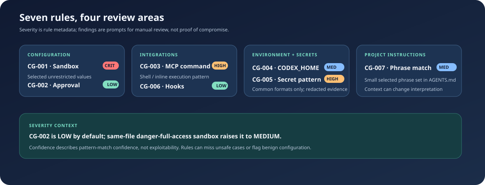

# Security Documentation

CodexGuard provides bounded local heuristics and evidence for manual review. Its controls and detection coverage are intentionally limited.

| Topic | Guide |
|---|---|
| Rule logic and severities | [Security Rules](../security-rules.md) |
| Assets, trust boundaries, threats, and residual risk | [Threat Model](../threat-model.md) |
| Implemented controls and guarantees | [Security Model](../security-model.md) |
| File traversal and reads | [Filesystem Safety](filesystem-safety.md) |
| Image and runtime controls | [Docker Guide](../docker-guide.md) |
| Human review practices | [Security Checklist](../security-checklist.md) |

No finding is a definitive vulnerability verdict. No findings do not establish safety. CodexGuard does not execute scanned content, repair files, or block an agent.
