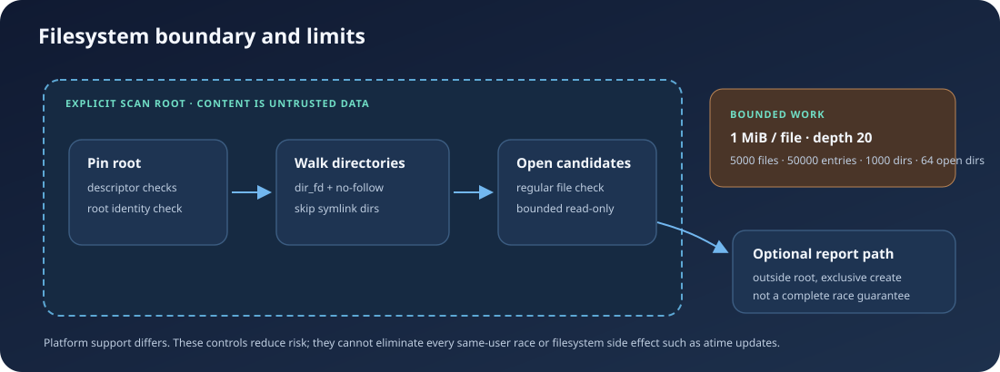

# Filesystem Safety

CodexGuard treats the selected repository as untrusted data and attempts to keep discovery and reads inside the explicit root. This document summarizes implemented protections in [`codexguard/scanner.py`](../../codexguard/scanner.py) and [`codexguard/config_parser.py`](../../codexguard/config_parser.py), plus remaining limits.

## Discovery boundary

The scanner accepts a user-selected root and considers only:

- files named `AGENTS.md` at any traversed depth;
- `config.toml` files whose immediate parent directory is named `.codex`;
- `.env.example` and `.env.*.example` files.

It does not scan arbitrary source code, `CLAUDE.md`, the entire home directory, or every possible Codex configuration layer.

## Descriptor-based traversal

`scanner._open_root_directory` requires `O_NOFOLLOW` and `O_DIRECTORY`, opens each root component relative to a pinned directory descriptor, and fails with an unsupported-platform error if those flags are unavailable. `_walk_and_inspect` also requires descriptor-aware `os.scandir`. It compares the root's device/inode to the pinned descriptor. Child directories are opened relative to their parent descriptor with directory/no-follow flags. Symlinked directories are skipped; relevant symlink files are skipped rather than read.

`_read_entry` opens a candidate relative to the parent descriptor with `O_NOFOLLOW` where available and `O_NONBLOCK`, checks the opened descriptor is a regular file, checks size, and reads at most max-bytes plus one byte. The TOML parser's standalone file APIs resolve and constrain paths to the selected root, then use descriptor-based component walking with no-follow flags where available. Its documented fallback on platforms without the relevant primitives has a wider race window. The scanner itself fails closed when its required traversal capabilities are absent.

These mechanisms reduce path traversal and selected replacement races. They do not provide complete protection against every OS/filesystem behavior or hostile concurrent process. Reads may update access time depending on the filesystem; the application does not write to restore metadata.

## Resource limits

Defaults in [`codexguard/constants.py`](../../codexguard/constants.py):

| Limit | Value | Purpose |
|---|---:|---|
| `DEFAULT_MAX_FILE_BYTES` | 1 MiB | Bound each candidate read. |
| `DEFAULT_MAX_FILES` | 5,000 | Bound relevant files inspected. |
| `DEFAULT_MAX_ENTRIES` | 50,000 | Bound directory entries visited, including irrelevant entries. |
| `DEFAULT_MAX_DIRECTORIES` | 1,000 | Bound directories visited. |
| `DEFAULT_MAX_DEPTH` | 20 | Bound traversal depth. |
| `DEFAULT_MAX_OPEN_DIRECTORIES` | 64 | Bound queued/open directory descriptors. |

Reached limits are included in `ScanResult.summary.limits_reached`. Oversized, malformed, unreadable, or non-regular inputs are skipped with sanitized per-file errors where scanning can continue. Limits bound application traversal and input bytes, not all parser memory or operating-system work.

## Report output boundary

Scanning opens input files for reading and does not intentionally write to the selected tree. If `--output` is explicitly provided, `reporter.write_report` resolves the destination, refuses paths inside the root, refuses existing files and symlinked paths, requires an existing parent directory, and uses exclusive creation. This output must live outside the scan root. A same-user concurrent process with write access to both locations can still race a newly created output, including by creating a hard link during writing; keep report directories private.

## Non-goals

Filesystem checks do not make the code a formal sandbox, guarantee cross-platform behavior, prove the selected root is trustworthy, or eliminate same-user concurrency races. See the [Threat Model](../threat-model.md) and [Security Model](../security-model.md).
