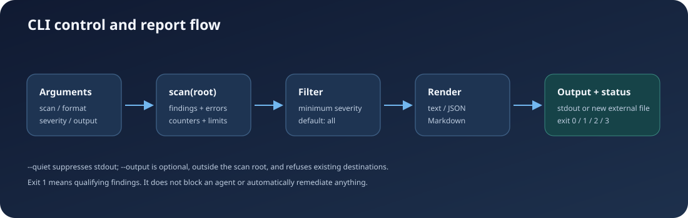

# Report Formats

`codexguard/reporter.py` renders the same `ScanResult` as terminal text, JSON, or Markdown. All formats include summary counts and finding/error information appropriate to the format. Serialization redacts common secret patterns from user-derived fields; redaction coverage is heuristic.



## Text

The default format prints the application/version, root, files scanned/skipped, findings/errors, reached limits, each finding's severity/rule/title/file, description, assessment/confidence, evidence, and recommendation. Per-file errors appear as error lines. A clean finding list prints `No findings.`

Use text for interactive review:

```sh
codexguard scan ./project
```

## JSON

JSON is produced by `render_json` from `ScanResult.to_dict`, formatted with two-space indentation and stable key sorting. The top-level object contains `tool`, `version`, redacted `scan_root`, `summary`, `findings`, and `errors`. Summary includes files scanned/skipped, entries and directories visited, finding/error counts, and `limits_reached`. Finding fields include rule identity, severity, assessment, confidence, title, file, location, description, evidence, rationale, and recommendation. Errors contain file, stable code, and sanitized message.

```sh
codexguard scan ./project --format json
```

The schema represents scan evidence; it is not a policy decision format and does not imply that the report is safe to publish. Treat paths and evidence as potentially sensitive even with redaction.

## Markdown

Markdown reports include a summary, a section for each finding, and a scan-errors section. Each finding shows its rule/title/severity, file/location, description, assessment/confidence, evidence, rationale, and recommendation.

```sh
codexguard scan ./project --format markdown
```

## Save a report

Use `--output` to request report file creation. The destination must be outside the scan root and must not already exist; the parent directory must already exist. `reporter.write_report` uses exclusive creation, restrictive initial file mode, and symlink checks where supported. It removes a partial output on a failed write. A concurrent same-user process may still race paths on some filesystems; use a private controlled reports directory.

```sh
mkdir -p reports
codexguard scan ./project --format json --output ./reports/audit.json
```

The report write is an intentional write to the explicitly named external destination. It is not a write to the scanned tree.
